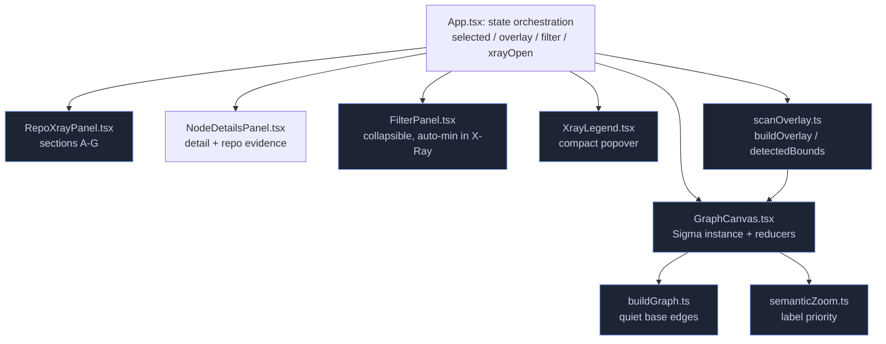
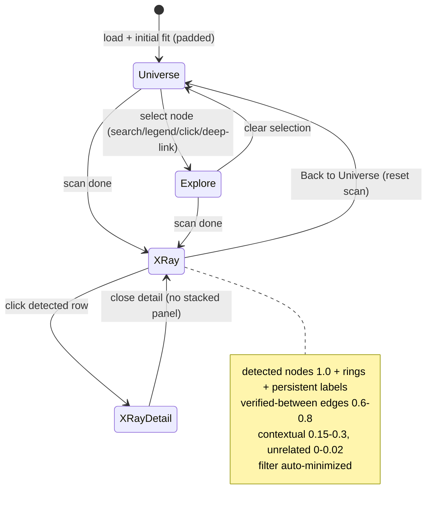

# Design Document: TechAtlas Phase 1.5 UI/UX Refinement

## Overview

This is a **frontend-only visual and interaction refinement** of the existing TechAtlas
app. It is explicitly **not** a rebuild, **not** a new rendering engine, and **not** a
backend/scanner/dataset change. Every change reuses and extends the already-audited
modules: `GraphCanvas.tsx` (imperative Sigma.js v3 instance), `buildGraph.ts`,
`scanOverlay.ts`, `semanticZoom.ts`, the sidebar/panel surfaces
(`RepoXrayPanel.tsx`, `NodeDetailsPanel.tsx`, `XrayLegend.tsx`, `FilterPanel.tsx`),
`App.tsx` orchestration, and the `:root` design tokens in `styles.css`.

The refinement has one dominant goal — **kill the "spiderweb" edge clutter** — plus a
set of supporting goals: a consistent three-state visual model, a label-priority system,
viewport-aware camera framing, a restructured Repo X-Ray sidebar, and collapsible
filter/legend chrome. Phase 1.5C additions layer on top: accurate display of
`dependency_classification`, always-visible partial-scan flagging, non-discarding
collapse of large unmapped lists, and concept-vs-tool presentation separation that never
alters canonical scanner results.

The app runs two Vite builds — the static GitHub Pages `dist` (no scanner) and
`dist-xray` (Repo X-Ray gated on `VITE_SCANNER_API`, live backend at
`techatlas.onrender.com`, scanner_version `1.5c.1`, dataset `0.3.0`, 417 nodes / 900
edges). All refinements must preserve both builds and all 20 non-negotiable principles
(§3) and the regression/safety list (§22).

---

# PART 1 — HIGH-LEVEL DESIGN

## 1. State Model

The app has exactly **three visual states**, owned by `App.tsx` and passed into
`GraphCanvas` as props. They are mutually exclusive in intent but share one Sigma
instance — the graph is never rebuilt and coordinates are never recomputed when the
state changes.

| State | Trigger | Who owns it | What changes |
|-------|---------|-------------|--------------|
| **Universe** | Default / cleared selection | `selected === null && overlay === null` | Overview framing; background edges maximally quiet; semantic-zoom labels only |
| **Explore** | A node is selected (search, legend, click, deep link) | `selected !== null && overlay === null` | Neighborhood of the active node promoted; everything else dims |
| **Repo X-Ray** | A scan completes (`scanPhase.kind === "done"`) | `overlay !== null` | Detected nodes get status rings + persistent labels; verified edges between detected nodes highlighted; the rest fades |

### Visual channels (consistent and independent across all states)

Each channel encodes exactly one thing and never collides with another. This is the
contract the reducers enforce.

| Channel | Encodes | Source | Invariant |
|---------|---------|--------|-----------|
| **Fill color** | Domain | `node.color` (from dataset) | Never replaced by detection status |
| **Size** | Popularity / connectivity | `node.size` | Never changed by selection or scan |
| **Ring (border)** | Detection status | `STATUS_RING` via `@sigma/node-border` | Only present in X-Ray; a *separate* channel from fill |
| **Position** | Relationship layout | precomputed `x`/`y` | Never mutated — no relayout, ever |
| **Edge presence** | A *verified* relationship | base graph edges only | Overlay never invents edges |
| **Label** | Identity | `node.label` | Gated by priority + zoom + density |
| **Opacity** | Relevance to the current state | reducer-computed | The primary clutter-control lever |

**Key principle:** fill (domain) and ring (status) are orthogonal. A node can be "Python
in the Languages domain" (blue-ish fill) and "confirmed in this repo" (green ring)
simultaneously, and both reads remain legible.

## 2. Edge-Clutter Reduction (highest priority)

The spiderweb comes from `buildGraph.ts` setting every base edge to
`rgba(140,150,170,0.18)` at size `0.6` — far above the 0.04–0.10 target for background
edges. Reduction is **context-sensitive**: edges are rendered per state, with concrete
target opacities enforced in the edge reducer rather than baked into the graph.

### Target opacity model per state

| State | Edge class | Target opacity | Mechanism |
|-------|-----------|----------------|-----------|
| **Universe** | All background edges | 0.04–0.10 | Lower base color in `buildGraph`; reducer leaves them |
| **Explore** | Edges touching the active node | prominent (~0.55) | `edgeReducer` active-neighbor branch |
| **Explore** | All other edges | dimmed (~0.04) | `DIM_EDGE` |
| **Repo X-Ray** | Verified edge between two detected nodes | 0.60–0.80 | `SCAN_HILITE_EDGE` (raised) |
| **Repo X-Ray** | Contextual edge (one endpoint detected) | 0.15–0.30 | **new** `SCAN_CONTEXT_EDGE` branch |
| **Repo X-Ray** | Fully unrelated edge | 0.0–0.02 | `SCAN_DIM_EDGE` (lowered) |

Correspondingly for nodes in X-Ray: detected nodes at full opacity (1.0), unrelated nodes
dimmed to 0.10–0.20 (`SCAN_DIM_NODE` raised slightly from 0.10 into that band so shape is
still faintly perceptible for context without competing).

The exact constants are specified in the LLD. The reducers already exist; this is a
re-tuning of constants plus one new edge branch (contextual), not new architecture.

## 3. Label Priority System

Labels must stay **WebGL-rendered by Sigma** (no hundreds of React DOM labels — perf
§18). The system extends `semanticZoom.ts`, which already exposes `bandOf(ratio)` and
`labelVisibleAtRatio(nodeType, size, ratio)`.

Priority order (highest wins when the density/collision budget is tight):

1. **Selected** node — always labelled
2. **Hovered** node — always labelled
3. In X-Ray: **confirmed-primary** (confirmed status, high popularity)
4. In X-Ray: **other confirmed**
5. In X-Ray: **declared**
6. In X-Ray: **inferred**
7. Semantic-zoom tier (domains first, then concepts, then technologies by size)

In X-Ray, **detected technologies get persistent labels** regardless of zoom band (that's
the whole point of a scan read), bounded by a maximum count so the canvas never floods.
Collision avoidance uses Sigma's native `labelDensity` / `labelGridCellSize` plus an
optional **label-beside-node** placement for dense clusters. A hard cap
(`MAX_PERSISTENT_LABELS`) bounds the persistent set.

## 4. Camera Framing

All framing uses the **precomputed coordinates**; the camera never triggers a relayout.

- **Initial universe fit**: frame the whole node spread with padding so it reads as a
  universe, not a zoomed-in corner. Clamp away from `minCameraRatio 0.08` so labels stay
  readable.
- **X-Ray fit**: the detected-region bounding box must be framed **offset for the open
  sidebar width** — the usable viewport is `width - sidebarWidth`, so the fit must bias
  the camera center left (on desktop) so detected nodes aren't hidden behind the panel.
- **Focus on Stack**: reuses the existing `fitSignal` bounding-box fit, re-tunable via
  nonce so the button works repeatedly.
- **Camera stability**: selecting a node animates the camera (existing `focusId` effect)
  but never relayouts.
- **Optional zoom / fit / reset controls**: small overlay buttons (zoom in, zoom out,
  reset-to-universe). These call existing camera APIs; no new engine.

## 5. Repo X-Ray Sidebar Information Hierarchy (sections A–G)

Restructure `RepoXrayPanel.tsx` into a clear top-to-bottom hierarchy. All metrics are
**source-backed** — read straight from real scanner output (`summary`, `coverage`,
`detections`, `unmapped`), never fabricated.

| Section | Content | Source field |
|---------|---------|--------------|
| **A. Header** | "Analyze a GitHub Repository" + exit control | static |
| **B. Repo identity** | owner/name link, description, primary language, commit SHA, branch | `scan.repository` |
| **C. Summary metrics** | compact counts: detected technologies / concepts / unmapped | `scan.summary.matched_technology_count`, `matched_concept_count`, `unmapped_package_count` |
| **D. Primary actions** | Focus on Stack · Open GitHub · Analyze Another · Back to Universe — with a clear primary/secondary visual hierarchy | actions |
| **E. Grouped detected stack** | detections grouped by domain, **concepts separated from tools** (presentation only), each row shows status + `dependency_classification` when present | `scan.detections` grouped by `node.primary_domain`, split by `detection.node_type` |
| **F. Unmapped dependencies** | collapsed `<details>`, never discarded; shows ecosystem + direct/transitive where evidence supports | `scan.unmapped` |
| **G. Coverage / partial banner** | always-visible partial flag + `coverage.notes` | `scan.status`, `scan.coverage` |

**Navigation:** Summary → node Details → back is handled **without stacking panels**.
Clicking a detected row navigates (`onFocusNode`) and opens `NodeDetailsPanel`; the X-Ray
panel and the detail panel are the same right-edge surface conceptually, so the detail
panel's close returns to the summary rather than layering a second floating panel.

### Phase 1.5C presentation rules (sidebar)

- **Concepts vs tools separation is presentation-only.** Grouping/splitting
  `node_type === "concept"` from `"technology"` changes layout, never the canonical
  detection list or ordering of truth.
- **Prioritize meaningful technologies over generic concepts** in the visual order
  (tools group rendered before a secondary concepts group) without removing or reordering
  canonical results within a group beyond a stable display sort.
- **`dependency_classification`** (`direct` / `transitive` / `undetermined`) is an
  *optional* field on `ScanDetection`; render a small inline badge **only when present**,
  and never imply a value when absent (show nothing, not "undetermined", unless the
  scanner says so).
- **Partial scans are always visibly flagged** (section G) — a partial scan must never
  look like full coverage.
- **Large unmapped lists collapse but are never discarded** — the count is always shown;
  the list is paginated/capped in display only, with a note that evidence is retained.

## 6. Domain Filter + Legend

- `FilterPanel.tsx` becomes **collapsible** and **auto-minimizes during X-Ray** (the
  X-Ray panel takes the right edge; the filter should not fight it).
- `XrayLegend.tsx` (Confirmed / Declared / Inferred / Related) becomes a **compact
  floating/popover** element, not a wide bar.
- **A11y**: status is never color-only. Each legend/detection row carries a text label and
  a shape/ring cue, satisfying the "not color alone" requirement already honored by the
  `status-*` text in `NodeDetailsPanel`.

## Architecture



## Components and Interfaces

| Component | Responsibility | Change in this phase |
|-----------|---------------|----------------------|
| `App.tsx` | State ownership, prop wiring, sidebar-width awareness for fit | Pass sidebar width to fit; auto-minimize filter in X-Ray |
| `GraphCanvas.tsx` | Sigma instance, node/edge reducers, camera | Re-tuned constants, new contextual-edge branch, persistent X-Ray labels, viewport-aware fit, optional camera controls |
| `buildGraph.ts` | API → Graphology graph | Quieter base edge color/size |
| `semanticZoom.ts` | Pure label-visibility logic | Add `labelPriority()` + persistent-label selection |
| `scanOverlay.ts` | Pure overlay derivation | **Unchanged invariants**; may add a `contextualEdges` set (one-endpoint-detected) without inventing edges |
| `RepoXrayPanel.tsx` | X-Ray sidebar | Sections A–G, classification badge, partial banner, concept/tool split, unmapped collapse |
| `NodeDetailsPanel.tsx` | Node detail | Back-nav returns to summary; classification/partial context |
| `FilterPanel.tsx` | Domain filters | Collapsible + auto-min |
| `XrayLegend.tsx` | Status legend | Compact popover |

## State / Flow Diagram



---

# PART 2 — LOW-LEVEL DESIGN

## Data Models

This phase introduces **no new backend models**. It reuses the existing API types
(`api/types.ts`) and the internal overlay type, with two additive, frontend-only
changes.

### Existing types reused (unchanged shape)
- `GraphResponse` / `GraphNode` / `GraphEdge` — the 417-node / 900-edge base graph; `node.color` (domain fill), `node.size` (popularity), `node.x`/`node.y` (precomputed layout).
- `RepoScan` with `summary`, `coverage` (incl. `partial`, `notes`), `detections`, `evidence`, `unmapped` — all source-backed scanner output, read as-is.
- `DetectionStatus` (`confirmed`/`declared`/`inferred`/`related`) — drives the ring channel.

### Additive change 1 — `ScanDetection.dependency_classification` (optional)
```typescript
export interface ScanDetection {
  // ...existing fields unchanged...
  dependency_classification?: "direct" | "transitive" | "undetermined" | null;
}
```
Optional and nullable — present only when the scanner emits it; rendered only when present.

### Additive change 2 — `ScanOverlay.contextualEdges`
```typescript
export interface ScanOverlay {
  statusByNode: Map<string, DetectionStatus>;
  highlightEdges: Set<string>;    // both endpoints detected (unchanged)
  contextualEdges: Set<string>;   // NEW: exactly one endpoint detected (still only existing edges)
  detectedNodes: Set<string>;
}
```

### New pure helper types (`semanticZoom.ts`)
`LabelPriority`, `LabelContext` (see §2.6) — in-memory only, no persistence.


The single biggest clutter fix. Change the default edge styling so the universe reads
calm; the reducers promote edges when relevant.

```typescript
// BEFORE (spiderweb):
//   size: 0.6, color: "rgba(140,150,170,0.18)"
// AFTER (quiet background, within 0.04-0.10 target):
const BASE_EDGE_COLOR = "rgba(140,150,170,0.06)"; // ~0.06 alpha, tunable (open question)
const BASE_EDGE_SIZE = 0.4;

graph.addEdgeWithKey(key, e.source, e.target, {
  relationshipType: e.relationship_type,
  size: BASE_EDGE_SIZE,
  color: BASE_EDGE_COLOR,
});
```

Nodes are unchanged (`size`, `color`, `borderColor`; domains keep `#ffffff` border).

## 2.2 `GraphCanvas.tsx` — new constants

```typescript
// Explore-state dimming (unchanged intent, re-tuned)
const DIM_NODE = "rgba(120,130,150,0.12)";
const DIM_EDGE = "rgba(120,130,150,0.04)";       // background target lower bound
const ACTIVE_EDGE = "rgba(180,200,255,0.55)";    // name the existing literal

// Repo X-Ray overlay
const SCAN_DIM_NODE   = "rgba(120,130,150,0.16)"; // 0.10 -> 0.16 (into 0.10-0.20 band)
const SCAN_HILITE_EDGE = "rgba(180,200,255,0.70)"; // 0.5 -> 0.70 (verified-between band)
const SCAN_CONTEXT_EDGE = "rgba(150,170,210,0.22)"; // NEW: one-endpoint-detected (0.15-0.30)
const SCAN_DIM_EDGE   = "rgba(120,130,150,0.02)";  // 0.035 -> 0.02 (unrelated, near 0)

// Label budget
const MAX_PERSISTENT_LABELS = 60; // bound X-Ray persistent labels (perf §18) — tunable

// Sigma settings re-tune (open questions, validate against screenshots):
// labelDensity 0.7 -> ~0.5 (fewer, cleaner), labelGridCellSize 70 -> ~90
```

All values marked *tunable* are **open questions** to finalize against real screenshots
(see §Open Questions); the listed numbers are recommended starting defaults.

## 2.3 Node reducer — per-state logic

```
nodeReducer(node, dataIn):
    res = { ...dataIn }

    # 1. Filter (Phase 1B) wins first — hidden nodes stay hidden
    if visibleNodes and node not in visibleNodes: res.hidden = true; return res

    # 2. Repo X-Ray overlay
    if scanStatus:
        status = scanStatus.get(node)
        if status:
            res.type = "bordered"                 # ring channel
            res.borderColor = STATUS_RING[status] # status != domain fill
            res.borderSize = 3
            res.zIndex = 2
            # PERSISTENT label for detected nodes, within budget + priority
            res.label = persistentLabelFor(node, status) ? dataIn.label : ""
            # res.color (domain fill) and res.size UNCHANGED
            return res
        # not detected -> faint context, no label
        res.color = SCAN_DIM_NODE; res.label = ""; res.zIndex = 0
        return res

    # 3. Semantic-zoom gating (Universe)
    if not labelVisibleAtRatio(nodeType, size, ratio): res.label = ""

    # 4. Explore highlight (active neighborhood)
    if active:
        if neighborSet.has(node):
            if node == active: res.zIndex=2; res.highlighted=true; res.label=dataIn.label
            return res
        res.color = DIM_NODE; res.label = ""; res.zIndex = 0
    return res
```

`persistentLabelFor` consults the precomputed label-priority set (below), so label choice
is O(1) per node per frame — no per-node scans.

## 2.4 Edge reducer — per-state logic (adds contextual branch)

```
edgeReducer(edge, dataIn):
    # Filter first
    if visibleEdges and edge not in visibleEdges: return { ...dataIn, hidden: true }

    # Repo X-Ray
    if scanEdges or scanContextEdges:
        if scanEdges.has(edge):        return {color: SCAN_HILITE_EDGE, size: 1.4, zIndex: 1}  # 0.6-0.8
        if scanContextEdges.has(edge): return {color: SCAN_CONTEXT_EDGE, size: 0.8, zIndex: 0} # 0.15-0.3  NEW
        return {color: SCAN_DIM_EDGE, zIndex: 0}                                                 # ~0.02

    # Explore
    if active:
        [s,t] = extremities(edge)
        if s==active or t==active: return {color: ACTIVE_EDGE, size: 1.4, zIndex: 1}
        return {color: DIM_EDGE, zIndex: 0}

    # Universe: leave quiet base edges as-is
    return dataIn
```

`scanContextEdges` is derived purely (next section) and is `null` when not in X-Ray.

## 2.5 `scanOverlay.ts` — contextual edges (invariant-preserving)

Extend `ScanOverlay` with `contextualEdges`: existing edges where **exactly one** endpoint
is detected. This still **never invents edges** — it only classifies edges the base graph
already has.

```typescript
export interface ScanOverlay {
  statusByNode: Map<string, DetectionStatus>;
  highlightEdges: Set<string>;    // BOTH endpoints detected  (unchanged)
  contextualEdges: Set<string>;   // NEW: exactly ONE endpoint detected
  detectedNodes: Set<string>;
}

// inside buildOverlay, iterating graph.edges (same loop, extra branch):
for (const e of graph.edges) {
  const a = detectedNodes.has(e.source), b = detectedNodes.has(e.target);
  if (a && b) highlightEdges.add(e.id);
  else if (a || b) contextualEdges.add(e.id);
}
```

`detectedBounds()` is unchanged.

## 2.6 `semanticZoom.ts` — label-priority algorithm

```typescript
export type LabelPriority = 0 | 1 | 2 | 3 | 4 | 5 | 6; // 0 highest

export interface LabelContext {
  selectedId: string | null;
  hoveredId: string | null;
  scanStatus: Map<string, DetectionStatus> | null;
  popularityOf: (id: string) => number; // from node.size / popularity
}

// Pure: assign a priority to a node id (lower = more important).
export function labelPriority(id: string, ctx: LabelContext): LabelPriority {
  if (id === ctx.selectedId) return 0;
  if (id === ctx.hoveredId)  return 1;
  const s = ctx.scanStatus?.get(id);
  if (s === "confirmed") return ctx.popularityOf(id) >= CONFIRMED_PRIMARY_POP ? 2 : 3;
  if (s === "declared")  return 4;
  if (s === "inferred")  return 5;
  return 6; // falls back to semantic-zoom gating
}

// Pure: choose the persistent-label set for X-Ray, bounded by budget.
// Sort detected ids by priority then popularity desc, take first `budget`.
export function selectPersistentLabels(
  detectedIds: string[], ctx: LabelContext, budget: number,
): Set<string> { /* sort + slice; deterministic */ }
```

`GraphCanvas` computes `selectPersistentLabels` **once per overlay change** (not per
frame) and stores it in a ref the node reducer reads.

## 2.7 Camera-fit math — viewport-aware (sidebar offset)

The detected bounds must be framed in the **usable** viewport (full width minus the open
sidebar). On desktop the sidebar is on the right, so the camera center shifts so detected
nodes land in the left/clear region.

```typescript
interface FitOptions {
  sidebarWidthPx: number;   // 0 when no panel open; panel width when X-Ray/detail open
  viewportWidthPx: number;
  viewportHeightPx: number;
  padding: number;          // fraction, e.g. 0.15
}

// Given detected bounds (graph space) and the full node spread:
//   usableFrac = (viewportWidth - sidebarWidth) / viewportWidth
//   spanRatio  = max(gw/fullW, gh/fullH)
//   ratio      = clamp(spanRatio * (1 + padding) / usableFrac, MIN_FIT_RATIO, 1.1)
//   centerX normalized, then shift LEFT by half the sidebar's normalized width:
//     nx = ((cx - fullMinX)/fullW) - (sidebarWidth / viewportWidth) / 2
//     ny = 1 - (cy - fullMinY)/fullH
//   camera.animate({x: nx, y: ny, ratio}, {duration: prefersReduced ? 0 : 600})
```

The **initial universe fit** is the same math with `sidebarWidthPx = 0` and a larger
padding so it reads as an overview and stays clamped away from `minCameraRatio`.

## 2.8 Optional camera controls

Small overlay buttons wired to existing Sigma camera APIs:

```typescript
// zoom in/out: camera.animatedZoom / animatedUnzoom
// reset: animate to the initial universe fit (sidebarWidthPx = 0)
// respect prefers-reduced-motion (duration 0)
```

No new dependency; pure UI over the existing camera.

## 2.9 Sidebar DOM / section structure (`RepoXrayPanel.tsx`)

```
<section class="xray-panel">                      // existing surface, restyled
  <header class="xray-header"> A. title + exit
  <section class="xray-repo">  B. repo identity (owner/name, desc, lang, commit, branch)
  <ul class="xray-metrics">    C. compact metrics (tech / concepts / unmapped counts)
  <nav class="xray-actions">   D. Focus on Stack (primary) · Open GitHub · Analyze Another · Back
  <div class="xray-stack">     E. grouped detected stack
       <div class="xray-tools">    tools group (node_type === "technology"), by domain
       <div class="xray-concepts"> concepts group (node_type === "concept"), secondary
            each row: <status ring/dot> label <status text> [<classification badge?>]
  <details class="xray-unmapped"> F. collapsed, count shown, capped display + retained note
  <div class="xray-coverage">  G. partial banner (if status==="partial") + coverage.notes
</section>
```

- **Classification badge** renders only when `detection.dependency_classification` is a
  present string (`direct` / `transitive` / `undetermined`):
  `{d.dependency_classification && <span class="xray-class">{d.dependency_classification}</span>}`.
- **Partial banner** always renders when `scan.status === "partial"`, listing
  `coverage.notes`; it must be visually distinct (warning styling) and never suppressed.

This requires an **additive type change** (frontend only — not a backend change): add the
optional field to `ScanDetection` in `api/types.ts`:

```typescript
export interface ScanDetection {
  // ...existing fields...
  dependency_classification?: "direct" | "transitive" | "undetermined" | null;
}
```

## 2.10 CSS token additions (richer but no radical recolor)

Extend `:root` with a consistent scale derived from the existing palette — same hues,
more steps. No existing token is removed or re-hued.

```css
:root {
  /* existing: --bg --panel --panel-border --text --text-dim --accent --radius */

  /* elevation / surfaces */
  --panel-2: #0c1017;          /* inset inputs/rows */
  --panel-hover: rgba(122,162,247,0.12);

  /* text scale */
  --text-strong: #e6ebf5;

  /* status (match STATUS_RING exactly) */
  --status-confirmed: #4ade80;
  --status-declared:  #60a5fa;
  --status-inferred:  #fbbf24;
  --status-related:   #c0caf5;

  /* classification badge */
  --class-direct: #9bb4f9;
  --class-transitive: #8a93ab;

  /* radii / spacing scale */
  --radius-sm: 6px;
  --radius-lg: 14px;
  --space-1: 4px; --space-2: 8px; --space-3: 12px; --space-4: 16px;
}
```

---

## Correctness Properties

These are the invariants every change must preserve. Each maps to a test.

### Property 1: Overlay never adds edges
`highlightEdges ∪ contextualEdges ⊆ { e.id | e ∈ graph.edges }`. For any scan/graph pair, no overlay edge id is absent from the base graph.

**Validates: Requirements 1.3, 1.4, 4.1, 4.2, 4.3, 4.4**

### Property 2: Domain fill is never replaced by status color
In the X-Ray node reducer, `res.color` for a detected node equals its domain `dataIn.color`; status appears only on `borderColor`.

**Validates: Requirements 9.1, 9.2, 9.3**

### Property 3: Node coordinates never mutate on selection or scan
For all nodes, `x`/`y` after any state transition equal the values from `buildGraph`.

**Validates: Requirements 11.3, 13.4, 32.2**

### Property 4: Partial scan is always visibly flagged
`scan.status === "partial"` ⇒ the partial banner is rendered (section G).

**Validates: Requirements 23.1, 23.2, 23.3**

### Property 5: Unmapped is never discarded
The reported unmapped count equals `scan.unmapped.length`; collapsing/capping affects display only.

**Validates: Requirements 20.2, 20.3**

### Property 6: Label count is bounded
The persistent X-Ray label set size ≤ `MAX_PERSISTENT_LABELS` for any detected set.

**Validates: Requirements 5.1, 5.2, 5.3**

### Property 7: Reduced motion respected
When `prefers-reduced-motion: reduce`, all camera animations use duration 0.

**Validates: Requirements 29.1, 29.2**

### Property 8: Status conveyed with text, not color alone
Every status indicator (legend, detection row, detail panel) has an adjacent text label.

**Validates: Requirements 25.3, 28.3**

### Property 9: Concept/tool split is presentation-only
The union of rendered rows equals `scan.detections`; no detection is dropped or its status changed by grouping.

**Validates: Requirements 18.1, 18.3, 18.4**

### Property 10: Classification shown only when present
A classification badge renders iff `detection.dependency_classification` is a non-null string.

**Validates: Requirements 19.1, 19.2, 19.3**

### Property 11: No relayout on filter/select/scan
The graph instance is rebuilt only when `data`/`onSelect` identity changes (existing effect deps), never on filter/selection/overlay changes.

**Validates: Requirements 30.2, 32.1**

### Property 12: Edge opacity bands honored per state
Reducer output alpha for each edge class falls in its target band (Universe background ≤ 0.10; verified-between 0.60–0.80; contextual 0.15–0.30; unrelated ≤ 0.02).

**Validates: Requirements 1.1, 1.2, 2.1, 2.2, 2.3, 2.4, 2.5, 3.1, 3.2, 3.3**

## Error Handling

| Scenario | Condition | Response | Recovery |
|----------|-----------|----------|----------|
| Scan failed | `scan.status === "failed"` or scanner error code | Existing `RepoXrayPanel` error block (`errorTitle` + message + optional retry-after) | User can Analyze Another; graph stays in Universe/Explore |
| Partial scan | `scan.status === "partial"` | Always-visible partial banner (section G) + `coverage.notes`; results shown but flagged incomplete (Property 4) | None needed — partial results are valid, just labelled |
| Detected node missing from graph | detection `node_id` not in the 417-node graph | `buildOverlay` already skips it (only canonical existing nodes); no ring, no invented node | Silent, correct by design |
| No matches | `scan.detections.length === 0` | Existing "No technologies matched" empty state; unmapped still shown if present | User can Analyze Another |
| Classification absent | `dependency_classification` null/undefined | Render no badge (never imply a value) | N/A |
| Fit with no detected coords | detected nodes lack `x`/`y` | `detectedBounds` returns null → skip camera fit | Camera stays put; no crash |
| Deep link to unknown slug | slug not found | Existing behavior preserved — no selection | Universe state |

## Testing Strategy

### Unit (vitest) — pure logic
- `semanticZoom.ts`: `labelPriority` ordering (selected > hovered > confirmed-primary > confirmed > declared > inferred > zoom); `selectPersistentLabels` respects budget and is deterministic.
- `scanOverlay.ts`: `buildOverlay` classifies both-detected → `highlightEdges`, one-detected → `contextualEdges`, none → neither; **never emits an edge id not in the graph** (property-style test over random detected subsets) — covers Property 1.
- New camera-fit helper: `sidebarWidthPx` offset shifts center left and never exceeds clamp bounds (Property on usableFrac).

### Component (vitest + Testing Library)
- `RepoXrayPanel`: sections A–G render in order; **partial banner** appears iff `status==="partial"` (Property 4); **unmapped collapse** shows full count and retains list (Property 5); **classification badge** shows only when field present (Property 10); **concept/tool split** renders every detection exactly once (Property 9).
- `NodeDetailsPanel`: back-nav returns to the X-Ray summary without a second stacked panel; status rows carry text (Property 8).
- `FilterPanel`: collapses; auto-minimizes when X-Ray is open.

### Browser (Playwright)
- Smoke on **both builds** (`dist` and `dist-xray`): app loads, universe fit is padded (not zoomed into a corner), select a node → Explore dimming, clear → Universe.
- X-Ray e2e (`dist-xray`): run a known public repo scan → detected rings + persistent labels, Focus on Stack frames detected region clear of the sidebar, partial-scan fixture shows banner.

### Screenshot-based visual validation (mandatory — §21)
- Capture **before/after** at representative viewports (desktop wide, laptop, tablet, mobile) for: Universe (edge quietness — verify spiderweb gone), Explore (neighborhood prominence), X-Ray (ring/label legibility, sidebar hierarchy, partial banner).
- Inspect rendered output to **tune the open-question values** (base edge alpha, `labelDensity`/`labelGridCellSize`, `MAX_PERSISTENT_LABELS`, dim/hilite bands) against real screenshots before finalizing.

## Phased Implementation Mapping

| Phase | Scope | Primary files |
|-------|-------|---------------|
| **UI-A — Graph clarity** | Quiet base edges; re-tuned DIM/HILITE/SCAN constants; contextual-edge branch; per-state reducers | `buildGraph.ts`, `GraphCanvas.tsx`, `scanOverlay.ts` |
| **UI-B — Sidebar** | Sections A–G; metrics; actions hierarchy; concept/tool split; unmapped collapse; classification badge; partial banner | `RepoXrayPanel.tsx`, `api/types.ts`, `NodeDetailsPanel.tsx` |
| **UI-C — Layout** | Label-priority + persistent labels; viewport-aware camera fit; optional zoom/fit/reset controls | `semanticZoom.ts`, `GraphCanvas.tsx`, `App.tsx` |
| **UI-D — Responsive / a11y** | Collapsible filter + auto-min; compact legend popover; mobile bottom-sheet; not-color-only; reduced-motion | `FilterPanel.tsx`, `XrayLegend.tsx`, `styles.css` |
| **UI-E — Verification** | Unit + component + Playwright + screenshot tuning; regression pass against §22 | all + tests |

## Open Questions (recommended defaults to tune against screenshots)

1. **Base edge alpha** — default `0.06` (within 0.04–0.10); finalize per §21 screenshots.
2. **`labelDensity` / `labelGridCellSize`** — default `~0.5` / `~90` (from 0.7 / 70); tune for collision-free reads.
3. **`MAX_PERSISTENT_LABELS`** — default `60`; raise/lower based on dense-monorepo scans.
4. **X-Ray band values** — `SCAN_DIM_NODE` 0.16, `SCAN_HILITE_EDGE` 0.70, `SCAN_CONTEXT_EDGE` 0.22, `SCAN_DIM_EDGE` 0.02; confirm legibility.
5. **Sidebar fit padding** — default `0.15`; adjust so detected nodes clear the panel on laptop widths.
6. **Label-beside-node** — enable only in dense clusters; threshold TBD via screenshots.

## Non-Negotiables & Safety (honored)

- **No backend/scanner/dataset/canonical-id changes.** The only type edit is an *additive,
  optional* frontend field already emitted by the scanner.
- Preserve: search, filters, Wikipedia summaries, deep links, popularity sizing, evidence
  URLs, rate limiting, caching, both deployment builds (§22).
- Preserve the 417-node graph and all verified relationships; add no new rendering engine
  or heavy dependency; reuse `GraphCanvas`, `scanOverlay`, `semanticZoom`, `buildGraph`.
- Phase 1.5C detection coverage (Rust / Java-Kotlin / Go / Python / JS-TS),
  `component_paths` per workspace for monorepos, and distinct detection-vs-domain channels
  are all preserved — this phase changes **presentation only**.
