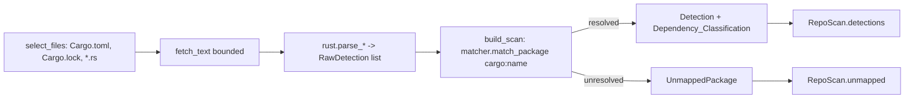

# Design — TechAtlas Phase 1.5C: Scanner Expansion

**Status:** Design proposal for review. Realizes `requirements.md` (Phase 1.5C) against the
audited scanner in `backend/app/scanner/`. No implementation authorized yet; signatures and
pseudocode below are illustrative of intended shape, not code to merge.

## Overview

Phase 1.5C widens the Repo X-Ray scanner's **detection breadth and accuracy** without
touching its pipeline shape, its read-only overlay contract, or its determinism. Everything
is additive: new ecosystem `Parser_Module`s plug into the existing per-file parse step, the
shared matcher/consolidation stays the single pipeline, and one optional field is added to
`Detection`. No canonical nodes/edges are created, no repository code is executed, and all
work stays inside the existing `Scan_Deadline` and `Scan_Budgets`.

The existing pipeline (verified in `scan_orchestrator.py`) is:

```
run_scan(url)
  → repository_resolver.resolve           # URL → owner/name/commit SHA (unchanged)
  → tree_inspector.select_files           # pick files within budgets   [EXTEND globs]
  → tree_inspector.fetch_text (per file)  # bounded text fetch           (unchanged)
  → _parse_file(path, kind, text)         # dispatch to a Parser_Module  [ADD dispatch]
      ├─ js.*        (npm)
      ├─ python.*    (pypi)
      ├─ infra.*     (docker / compose / actions)
      ├─ rust.*      (cargo)   ← NEW
      ├─ java.*      (maven)   ← NEW
      └─ go.*        (go)      ← NEW
  → build_scan(...)                        # match + consolidate + classify  [EXTEND]
      ├─ TechnologyMatcher.match_package   # (ecosystem, package) → node id  [EXTEND data]
      ├─ per-node consolidation (1 Detection, many Evidence, _STATUS_RANK)
      ├─ Dependency_Classification (NEW optional attribute on Detection)
      ├─ concept inference (tightened, evidence-backed)
      └─ UnmappedPackage recording (+ "unknown" ecosystem fallback)
  → RepoScan
```

Three things change in code paths; nothing changes in pipeline topology:

1. `tree_inspector` learns new manifest/source globs (Cargo/Maven/Gradle/Go), still budget-bounded.
2. `_parse_file` dispatches new file kinds to the three new `Parser_Module`s.
3. `build_scan` computes `Dependency_Classification` and keeps the existing dedupe/false-positive logic.

A new **offline Evaluation_Harness** (test-tree only, no runtime change) measures precision/recall
against a `Verified_Corpus` and gates on an `Accuracy_Threshold`.

### Design principles carried in (binding)

Overlay not rebuild · deterministic static analysis (no LLM, no code execution, no network
dependency resolution) · reuse the one canonical catalog read-only (`package`/`repo`/`aliases`
+ `import_aliases.json`) · one `Parser_Module` per ecosystem behind a shared pipeline · never
fabricate nodes/edges/percentages · every `Detection` carries file-and-`Locator` evidence ·
`GITHUB_TOKEN` server-side · all tests offline.

## Architecture

### Module layout (additive)

```
backend/app/scanner/
  scan_orchestrator.py        # EXTEND: _parse_file dispatch + classification wiring
  tree_inspector.py           # EXTEND: new manifest/source globs within budgets
  technology_matcher.py       # UNCHANGED logic; EXTEND dataset + import_aliases.json
  import_role.py              # UNCHANGED (roles derive from node_subtype)
  models.py                   # ADD optional Detection.dependency_classification + Literal
  manifest_parsers/
    common.py                 # EXTEND RawDetection: optional scope/section metadata
    js.py        python.py    infra.py            # UNCHANGED (coverage grows via dataset)
    rust.py                   # NEW: Cargo.toml / Cargo.lock / *.rs
    java.py                   # NEW: pom.xml / build.gradle(.kts) / libs.versions.toml
    go.py                     # NEW: go.mod / go.sum / *.go
  evaluation/                 # NEW (test-support, no runtime dependency)
    harness.py                # run Scanner over Verified_Corpus, compute metrics
    corpus/<fixture>/         # offline tree fixtures + ground-truth.json per repo
```

### Component responsibilities

| Component | Responsibility in 1.5C | Change |
|---|---|---|
| `tree_inspector.select_files` | Select Cargo/Maven/Gradle/Go manifests + `.rs`/`.go` sources inside `max_files`/`max_source_files`/`max_bytes` | extend globs only |
| `rust.py` / `java.py` / `go.py` | Parse ecosystem files → `RawDetection`, fail gracefully (0 detections) | new modules |
| `common.RawDetection` | Carry per-dependency `direct` plus optional `section`/`scope` metadata | additive fields |
| `technology_matcher` | Resolve `cargo`/`maven`/`go`/expanded `npm`/`pypi` identifiers via dataset only | dataset + alias data |
| `build_scan` | Consolidate (1 node = 1 Detection), set `Dependency_Classification`, tighten concepts, record unmapped | extend |
| `models.Detection` | Expose `dependency_classification` distinct from `detection_status` | additive optional field |
| `evaluation/harness.py` | Offline precision/recall + threshold gate + FP/FN report | new test-support |

### Data flow for a new ecosystem (Rust example)



## Components and Interfaces

### 1. New parser modules (one per ecosystem)

Each module mirrors the existing `manifest_parsers` pattern: pure functions
`(path: str, text: str) -> list[RawDetection]`, no network, no code execution, safe parsing,
and **literal-only** output (a crate/module/coordinate must appear verbatim in the file).
Each parser returns `[]` on unparseable input so the scan continues (NFR-5).

#### 1a. `rust.py` (ecosystem `cargo`) — R1

```python
# Cargo.toml: [dependencies], [dev-dependencies], [build-dependencies] via tomllib
def parse_cargo_toml(path, text) -> list[RawDetection]:
    # each declared crate → RawDetection(ecosystem="cargo", package=name,
    #   detection_status="declared", direct=True, section="dependencies"|"dev"|"build",
    #   rule="rust.cargo_toml")
    ...
# Cargo.lock: [[package]] tables (TOML) → transitive
def parse_cargo_lock(path, text) -> list[RawDetection]:
    # each locked pkg → RawDetection(ecosystem="cargo", detection_status="declared",
    #   direct=False, rule="rust.cargo_lock")
    ...
# *.rs sources: `use <crate>::...` and `extern crate <crate>;`
_USE_RE = re.compile(r"^\s*(?:pub\s+)?use\s+([A-Za-z_][A-Za-z0-9_]*)", re.M)
_EXTERN_RE = re.compile(r"^\s*extern\s+crate\s+([A-Za-z_][A-Za-z0-9_]*)", re.M)
_RUST_INTERNAL = {"crate", "self", "super", "std", "core", "alloc"}
def parse_source_imports(path, text) -> list[RawDetection]:
    # first path segment not in _RUST_INTERNAL → confirmed source_import with line number
    ...
```

- **R1.1/1.2** direct from `Cargo.toml`, transitive from `Cargo.lock`.
- **R1.3** external-crate `use`/`extern crate` → `confirmed` with `Locator` line; stdlib/self roots excluded.
- **R1.4** dev/build sections recorded on `RawDetection.section`, still `direct=True`.
- **R1.5/1.6/1.7** unparseable → `[]`; absent → no effect; literal-only, never fabricated.

#### 1b. `java.py` (ecosystem `maven`) — R2

```python
def parse_pom_xml(path, text) -> list[RawDetection]:
    # XML <dependency><groupId>/<artifactId>/<scope> → package "group:artifact",
    #   ecosystem="maven", declared; scope=="test" → scope="test"
    ...
def parse_gradle(path, text) -> list[RawDetection]:
    # static DSL scan of build.gradle / build.gradle.kts dependency lines:
    #   implementation "group:name:ver"  /  testImplementation(...)  → "group:name"
    #   configuration name → scope (testImplementation → test)
    #   catalog ref libs.x.y → resolve via gradle/libs.versions.toml when present
    ...
def resolve_version_catalog(catalog_text) -> dict[str, str]:
    # [libraries] alias = { group, name } → {"alias": "group:name"} (R2.3)
    ...
```

- **R2.1/2.2** coordinates `group:artifact` (Maven) and `group:name` (Gradle), ecosystem `maven`, declared.
- **R2.3** catalog aliases resolved from `gradle/libs.versions.toml` before emitting.
- **R2.4/2.5** Spring Boot coordinate → matcher resolves to node if it exists, else `UnmappedPackage`.
- **R2.6** test scope recorded (`<scope>test</scope>`, `testImplementation`).
- **R2.7** unparseable file → `[]`, scan continues.
- **R2.8** unresolved property/variable (`${springVersion}`) → emit the **literal unresolved coordinate text**, never a fabricated version/node. Gradle is parsed statically (no Groovy/Kotlin execution).

#### 1c. `go.py` (ecosystem `go`) — R3

```python
def parse_go_mod(path, text) -> list[RawDetection]:
    # `module <path>` captured as own-module; require(...) block / single-line require:
    #   external module → declared; `// indirect` → direct=False else True
    #   skip own-module prefix and stdlib paths
    ...
def parse_go_sum(path, text) -> list[RawDetection]:
    # each module line → declared, direct=False (go.sum alone never implies direct)
    ...
_IMPORT_BLOCK = re.compile(r'import\s*\((.*?)\)', re.S)
def parse_source_imports(path, text) -> list[RawDetection]:
    # quoted import paths; external module path → confirmed source_import with line
    ...
```

- **R3.1** `require` → declared; `direct=False` iff `// indirect`.
- **R3.2/3.5** own module path (from `module` directive) and stdlib paths excluded from both manifest and source.
- **R3.3** `go.sum` entries → declared, `direct=False` always.
- **R3.4** external import in `.go` → `confirmed` with `Locator` line.
- **R3.6** unparseable → `[]`, no fabrication, scan continues.

Go stdlib detection uses a heuristic that matches the codebase's "literal-only, never fabricate"
rule: an import path whose first segment contains no dot (no `host.tld`) is treated as stdlib/internal
and skipped (external modules are always `host/owner/repo` form). This avoids bundling a stdlib list
while never emitting a fabricated module.

### 2. `tree_inspector.select_files` extension (R1/R3 selection, R9 bounds)

New basenames/extensions added to the existing selection sets, **inside the same budgets**:

```python
MANIFEST_BASENAMES |= {
    "Cargo.toml", "Cargo.lock",                 # rust
    "pom.xml", "build.gradle", "build.gradle.kts", "libs.versions.toml",  # java
    "go.mod", "go.sum",                         # go
}
SOURCE_EXT |= {".rs", ".go"}
```

- `libs.versions.toml` is selected only under a `gradle/` path to avoid unrelated TOML.
- Source selection stays capped by `max_source_files` with the existing shallow-path preference,
  so adding `.rs`/`.go` cannot grow the source budget — it shares it (R9.3, NFR-6).
- Manifests remain the always-included high-signal set but still count against `max_files`; when
  the combined set exceeds `max_files`, the existing `skipped_limit` + partial labeling applies.
- Excluded dirs already cover `target/` (Rust/Java build output) and `vendor/` (Go); no change needed.

### 3. Matcher and dataset extensions (R4, R2.4/2.5)

`technology_matcher.py` logic is **unchanged** — it already resolves by ecosystem-qualified
`package`, `repo`, normalized name, and alias, and forbids loose substring. 1.5C only feeds it
more data, all centrally managed:

- New ecosystem labels used as the `package.ecosystem` key: **`cargo`**, **`maven`** (both Maven
  and Gradle — Gradle has no distinct registry label), **`go`**. These must match what dataset
  `package` entries and `import_aliases.json` use.
- Expanded `npm`/`pypi` coverage is **dataset-only**: add `package`/`repo`/`aliases` entries to
  existing canonical nodes. No code change, no new nodes. If a broadened mapping would need a node
  that does not exist, it is **not added** — the dependency becomes an `UnmappedPackage` (R4.3).
- Python import→distribution aliases (e.g. `sklearn` → `scikit-learn`) extend `import_aliases.json`
  (R4.4). An import absent from alias data and not an exact distribution match stays unmapped (R4.5).

**Mapping_Version bump (R4.6):** `mapping_version` is the dataset version already threaded into the
scan cache key alongside `SCANNER_VERSION`. Any change to dataset `package`/`repo`/`aliases` or to
`import_aliases.json` MUST bump the dataset `mapping_version`, so scans cached under the prior key
are not served as current. New parser logic (code) bumps `SCANNER_VERSION`; new mapping data bumps
`mapping_version`. Both are part of the key, so either kind of change invalidates stale cache entries.

### 4. `build_scan` consolidation, classification, and false-positive rules (R5, R7)

The existing consolidation is preserved and extended:

- **One `Detection` per node id** (R7.1): `by_node` keyed on node id; evidence ids accumulated.
- **Evidence union, each id once** (R7.1): evidence ids are generated per `RawDetection` and appended
  to exactly one node slot; a de-dupe guard drops a `(node_id, rule, file_path, line)` repeat so the
  same observation can't double-count.
- **Status = max rank** (R7.2): `_STATUS_RANK` (`related < inferred < declared < confirmed`) unchanged.
- **No zero-evidence detections** (R7.3): a node slot is only created when an evidence id is added;
  `build_scan` asserts every emitted `Detection` has ≥1 evidence id (invariant check).
- **Loose-substring guard** (R7.4): matching already forbids substring; additionally a `confirmed`
  status is only assigned from `source_import`/`source_usage` evidence that resolved through an exact
  matcher path, so a package merely *containing* "react" can never be `confirmed` as React.
- **Monorepo `component_paths` union** (R7.5): the existing top-level-segment component set is replaced
  by a **workspace path** (see §7) and stored once per contributing workspace.

#### `Dependency_Classification` (R5)

A new value computed in `build_scan`, separate from `detection_status`:

```python
DependencyClassification = Literal["direct", "transitive", "undetermined"]
```

Per node id, across all contributing `RawDetection`s for its ecosystem:

| Evidence seen for the node | Classification |
|---|---|
| Any manifest declaration (`direct=True` from a manifest rule) | `direct` (R5.2 — wins even if also in a lockfile) |
| Only lockfile/indirect evidence (`direct=False`, no manifest decl) | `transitive` (R5.3) |
| No parseable manifest decl **and** no parseable lockfile linkage | `undetermined` (R5.4) |
| Lockfile for the ecosystem present but unparseable | `undetermined` + coverage error note (R5.5) |

`detection_status` stays the closed `{confirmed, declared, inferred, related}` set (R5.6). Source
imports (`confirmed`) do not by themselves set `direct`; classification is driven by manifest vs
lockfile signals, so a `confirmed`+`undetermined` combination is valid and expected when only source
imports exist.

### 5. Concept inference tightening (R6)

Concept detections remain `RawDetection`s carrying an existing `concept:` node id (as `infra.py`
already does) with `detection_status="inferred"`, subject to tighter gates in the shared pipeline:

- **Existing nodes only** (R6.4/6.5): `build_scan` already drops any `node_id` the matcher does not
  have; a concept whose `concept:` id is absent is discarded, never created.
- **Artifact-backed only** (R6.1): every inferred concept must carry ≥1 evidence item referencing a
  concrete artifact (file path, manifest entry, or configuration key).
- **Capability ≠ concept** (R6.2): a dependency that merely *could* support a concept does not infer it.
- **Config presence ≠ outcome** (R6.3): a config file/key alone does not infer a deployment platform
  or outcome (consistent with existing "Dockerfile ≠ deployed" handling in `infra.py`).
- **No README / substring inference** (R6.6): a concept term appearing in README text or as a substring
  of a name never infers the concept.
- **No co-occurrence edges** (R6.5): the scanner emits detections only; it never creates a technology↔technology
  edge from two techs appearing in the same repo (read-only overlay).

### 6. Unmapped dependency handling (R8)

The existing `unmapped` map is retained and tightened:

- Any `(ecosystem, package)` that resolves to no node id becomes an `UnmappedPackage` with name,
  ecosystem, status, and ≥1 evidence id (R8.1), never dropped (R8.2), never fabricated into a node/edge/percentage (R8.3).
- `summary.unmapped_package_count` equals the number of recorded `UnmappedPackage`s, a non-negative integer (R8.4).
- **Fallback ecosystem** (R8.5): when a detected dependency has no resolvable ecosystem, it is recorded
  with `ecosystem="unknown"`, still carrying name/status/≥1 evidence id.

### 7. Monorepo handling (R9)

**Workspace discovery by manifest presence** (recommended default; see Open Questions): a `Workspace`
is any subdirectory that directly contains at least one supported manifest. This needs no ecosystem-specific
workspace-declaration parsing and is uniform across Cargo/npm/Maven/Gradle/Go.

- The **workspace path** is the directory of a contributing manifest (e.g. `services/api`), replacing the
  current top-level-segment heuristic for `component_paths`. A root-level manifest yields workspace `""`/root.
- **Per-workspace aggregation + union** (R9.1/9.2/7.5): a node detected in multiple workspaces produces one
  `Detection` whose `component_paths` lists each contributing workspace path exactly once (sorted, de-duped).
- **Bounded, each manifest once** (R9.5, NFR-6): selection already yields a unique file list; `build_scan`
  parses each selected file exactly once, so inspected-file and request counts cannot exceed `Scan_Budgets`
  regardless of repo size.
- **Budget/deadline adherence** (R9.3/9.4): the existing `deadline` and `max_files`/`max_source_files`/`max_bytes`
  checks in `run_scan`/`select_files` already stop work and set `coverage.partial`. 1.5C adds a coverage **note**
  identifying workspaces that were not inspected when a budget/deadline cut the scan short.

### 8. Evaluation harness (R10)

A new **offline, deterministic** test-support package under `backend/app/scanner/evaluation/`
(and/or the test tree), with **no runtime dependency** and **no live network** (R10.2, NFR-9).

#### Corpus and ground-truth format

```
evaluation/corpus/<fixture-name>/
  tree.json            # the selected file tree (paths + sizes) the mock GitHub client serves
  files/<path>         # verbatim manifest/source fixtures captured from a verified real repo
  ground-truth.json    # human-authored expected detections
```

```jsonc
// ground-truth.json
{
  "repository": "owner/name@sha",
  "ecosystems": ["cargo"],
  "expected_detections": [
    {"node_id": "technology:actix", "min_status": "declared", "classification": "direct"},
    {"node_id": "technology:serde", "classification": "direct"}
  ],
  "expected_unmapped": [{"name": "some-obscure-crate", "ecosystem": "cargo"}]
}
```

#### Harness interface

```python
@dataclass
class RepoEval:
    fixture: str
    precision: float   # 0.0–1.0
    recall: float      # 0.0–1.0
    false_positives: list[str]   # node ids reported but not in ground truth
    false_negatives: list[str]   # ground-truth node ids not reported

@dataclass
class EvalRun:
    per_repo: list[RepoEval]
    aggregate_precision: float
    aggregate_recall: float
    passed: bool

def run_evaluation(accuracy_threshold: float, *, scope="global") -> EvalRun:
    # for each corpus fixture: run Scanner against a MOCK GitHub client serving the fixture;
    # if any live network call is attempted → abort with an explicit error (R10.2)
    # compare reported node-id detection set vs ground truth → precision/recall (R10.3)
    # aggregate across corpus (R10.4); gate on threshold (R10.5); report FP/FN (R10.6)
    ...
```

- **Offline enforcement** (R10.2): the harness injects a GitHub client whose network layer raises if
  called with anything the fixture does not serve; any live attempt aborts the run with a clear error.
- **Metrics** (R10.3/10.4): precision = |TP| / |reported|, recall = |TP| / |ground truth|, both in 0.0–1.0,
  per repo and aggregated across the corpus.
- **Threshold gate** (R10.5): `Accuracy_Threshold` parameter; if aggregate precision or recall is below it,
  the run fails and names the metric and its computed value.
- **FP/FN report** (R10.6): per fixture, the count and identity of false positives/negatives.
- **Corpus coverage** (R10.7): ≥1 fixture per ecosystem (JS/TS, Python, Rust, Java/Kotlin, Go) + ≥1 monorepo.
- **No ungrounded accuracy** (R10.8): every reported accuracy value is computed from an evaluation run; no
  hardcoded percentages anywhere.

## Data Models

All changes are **additive and optional** (NFR-10). Existing `RepoScan`/`Evidence`/`ScanCoverage`/
`ScanSummary`/`UnmappedPackage` shapes are unchanged.

### `models.py` — additive

```python
# NEW closed literal, distinct from DetectionStatus
DependencyClassification = Literal["direct", "transitive", "undetermined"]

class Detection(BaseModel):
    node_id: str
    node_type: str
    role: str
    detection_status: DetectionStatus            # unchanged closed set
    evidence_ids: list[str] = Field(default_factory=list)
    component_paths: list[str] = Field(default_factory=list)
    # NEW — optional for backward compatibility; absent on old cached scans
    dependency_classification: DependencyClassification | None = None
```

- `DetectionStatus` and `EvidenceType` closed `Literal` sets are **unchanged** (R5.6).
- `SCANNER_VERSION` bumps for 1.5C code (e.g. `"1.5c.1"`); `mapping_version` bumps on dataset/alias changes.
  Both participate in the cache key, so a reader with no `dependency_classification` field never collides with
  a 1.5C scan under the same key.

### `common.py` — additive `RawDetection` metadata

```python
@dataclass(frozen=True)
class RawDetection:
    ecosystem: str | None
    package: str | None
    node_id: str | None
    evidence_type: str
    file_path: str
    description: str
    detection_status: str
    rule: str
    direct: bool = True
    line: int | None = None
    # NEW optional metadata carried to build_scan for classification/scoping
    section: str | None = None   # rust: "dependencies"|"dev"|"build"
    scope: str | None = None     # java/go: "test" etc. when known
```

These fields let `build_scan` compute `Dependency_Classification` and distinguish dev/build/test
dependencies without changing any output model besides the one optional `Detection` field.

### Evidence `Locator`

No model change: `Evidence.file_path` + optional `Evidence.line` already express the `Locator`.
New parsers populate `line` for source-import evidence (R1.3/R3.4).

## Correctness Properties

*A property is a characteristic or behavior that should hold true across all valid executions of a system — essentially, a formal statement about what the system should do. Properties serve as the bridge between human-readable specifications and machine-verifiable correctness guarantees.*

The scanner's core is pure, deterministic static analysis over text — parsers, a matcher, and a
consolidation step — so property-based testing applies well. The properties below were distilled
from the prework analysis, with redundant criteria consolidated (e.g. all no-fabrication criteria
collapse into one scan-level invariant plus one parser-level literal-token invariant).

### Property 1: No fabrication (scan-level)

*For any* repository fixture and dataset, every `node_id` appearing in `RepoScan.detections`
(technology or concept) is a member of the dataset's set of valid canonical node ids, the scan
produces no technology↔technology edges, and no confidence or progress percentage is emitted.

**Validates: Requirements 4.1, 4.3, 6.4, 6.5, 8.3, NFR-1, NFR-3**

### Property 2: Parser literal-token invariant

*For any* manifest or source text given to a `Parser_Module`, every package/coordinate/module
string in the resulting `RawDetection`s occurs literally (as a token) in the input text — no crate,
coordinate, version, or module path is synthesized.

**Validates: Requirements 1.7, 2.8, 3.6**

### Property 3: Graceful absence and unparseable input

*For any* input that is absent for an ecosystem or that cannot be parsed, the corresponding
`Parser_Module` returns zero detections and raises no exception, leaving detections from other
`Parser_Module`s unchanged.

**Validates: Requirements 1.5, 1.6, 2.7, 3.6, NFR-5**

### Property 4: Dependency flag reflects the source marker (per ecosystem)

*For any* generated Cargo/Go/npm/Python manifest and lockfile, each emitted `RawDetection.direct`
is True exactly when the source signal is a direct declaration (manifest `[dependencies]`, a
`require` line without `// indirect`) and False for lockfile entries or `// indirect` requires;
`go.sum` entries are always `direct=False`.

**Validates: Requirements 1.1, 1.2, 3.1, 3.3**

### Property 5: Confirmed source imports exclude internal/stdlib roots and carry a Locator

*For any* generated `.rs` or `.go` source file, the parser emits a `confirmed` `source_import`
`RawDetection` with a line number for each external crate/module root, and emits nothing for
internal roots (`crate`/`self`/`super`/`std`/`core`/`alloc`, the repository's own module path, or
Go standard-library paths).

**Validates: Requirements 1.3, 3.2, 3.4, 3.5**

### Property 6: Exact-match-only resolution (no loose substring)

*For any* identifier that is merely a substring of a canonical node's name/package but is not an
exact ecosystem-qualified `package`, `repo`, normalized-name, or approved-alias match, the Matcher
does not resolve it to that node (it stays unmapped), and no match is ever assigned `confirmed`
status for a technology on substring grounds alone.

**Validates: Requirements 4.2, 7.4**

### Property 7: Import-alias resolution

*For any* Python import name present in `import_aliases.json`, the Matcher resolves it to the same
canonical node as its mapped distribution name; *for any* import name absent from alias data that is
not an exact distribution match, the Matcher returns no node (recorded unmapped) without inferring a
distribution.

**Validates: Requirements 4.4, 4.5**

### Property 8: Mapping/scanner version keys invalidate cache

*For any* repository + commit SHA, two scans produced under different `(SCANNER_VERSION, mapping_version)`
pairs yield different cache keys, so a scan cached under a prior mapping version is never served after
the mapping data changes.

**Validates: Requirements 4.6**

### Property 9: Dependency_Classification determinism and precedence

*For any* set of per-node manifest/lockfile signals, `build_scan` assigns a `dependency_classification`
from the closed set {`direct`, `transitive`, `undetermined`}, where a manifest declaration yields
`direct` (even if the node also appears in a lockfile), lockfile-only yields `transitive`, and the
absence of both parseable manifest declaration and parseable lockfile linkage yields `undetermined`
and never `direct`.

**Validates: Requirements 5.1, 5.2, 5.3, 5.4, 5.6**

### Property 10: Detection status stays in the closed set and is independent of classification

*For any* produced `Detection`, `detection_status` is a member of {`confirmed`, `declared`,
`inferred`, `related`} and `dependency_classification` is carried as a separate attribute that never
alters `detection_status`.

**Validates: Requirements 5.6**

### Property 11: Concept inference is artifact-backed and existing-node-only

*For any* produced concept `Detection`, its node id exists in the canonical graph, its
`detection_status` is `inferred`, and it carries at least one `Evidence` item referencing a concrete
artifact (file path, manifest entry, or configuration key).

**Validates: Requirements 6.1, 6.4**

### Property 12: Consolidation — one Detection per node, unioned unique evidence, max-rank status

*For any* collection of `RawDetection`s that resolve to the same node id, `build_scan` produces
exactly one `Detection` for that node whose `evidence_ids` are the union of contributing evidence with
each id appearing exactly once, and whose `detection_status` is the highest-ranked contributing status
per `_STATUS_RANK` (`related` < `inferred` < `declared` < `confirmed`).

**Validates: Requirements 7.1, 7.2**

### Property 13: No zero-evidence detections

*For any* produced `RepoScan`, every `Detection` has at least one `Evidence` id.

**Validates: Requirements 7.3, NFR-8**

### Property 14: Monorepo workspace union and single detection

*For any* repository where the same dependency is observed in two or more workspaces, the scan
reports exactly one `Detection` for the corresponding node whose `component_paths` lists each
contributing workspace path exactly once.

**Validates: Requirements 7.5, 9.1, 9.2**

### Property 15: Unmapped completeness and retention

*For any* detected dependency that resolves to no canonical node, the scan records an
`UnmappedPackage` carrying its name, ecosystem (or `"unknown"` when no ecosystem resolves), detection
status, and at least one evidence id; no unmapped dependency is dropped and none is turned into a node.

**Validates: Requirements 8.1, 8.2, 8.5**

### Property 16: Unmapped summary count invariant

*For any* produced `RepoScan`, `summary.unmapped_package_count` is a non-negative integer equal to
the number of recorded `UnmappedPackage`s.

**Validates: Requirements 8.4**

### Property 17: Bounded work and each-file-once

*For any* repository tree, the number of files inspected does not exceed `max_files`, source files
do not exceed `max_source_files`, inspected bytes do not exceed `max_bytes`, and each selected file is
parsed exactly once (`files_inspected` equals the count of distinct selected files).

**Validates: Requirements 9.3, 9.5, NFR-6**

### Property 18: Consolidation idempotence

*For any* `RepoScan` produced by `build_scan`, re-running consolidation over the already-consolidated
detections' evidence yields an equal set of detections (same node ids, same unioned evidence, same
status, same `component_paths`) — consolidation is idempotent.

**Validates: Requirements 7.1, 7.2, 7.5**

### Property 19: Read-only overlay invariant

*For any* scan, running it does not mutate the shared canonical catalog: the Matcher's set of valid
node ids, dataset `package`/`repo`/`aliases` data, and node records are identical before and after the
scan.

**Validates: Requirements NFR-2, NFR-3**

### Property 20: Evaluation metric correctness

*For any* reported-detection set and ground-truth set, the harness computes precision = |TP|/|reported|,
recall = |TP|/|ground truth| (each in 0.0–1.0, with the degenerate empty-denominator cases defined),
and reports false positives = reported − truth and false negatives = truth − reported as set
differences.

**Validates: Requirements 10.3, 10.4, 10.6**

### Property 21: Evaluation threshold gate

*For any* evaluation run and `Accuracy_Threshold`, the run passes exactly when both aggregate precision
and aggregate recall are greater than or equal to the threshold; otherwise it fails and names the
metric(s) that fell below the threshold and their computed values.

**Validates: Requirements 10.5**

## Error Handling

- **Unparseable manifest/source:** each `Parser_Module` catches its own decode/parse errors
  (`tomllib.TOMLDecodeError`, `json.JSONDecodeError`, XML errors, malformed Gradle DSL) and returns
  `[]`. One bad file never aborts a scan (R1.5, R2.7, R3.6, NFR-5).
- **Unparseable lockfile with classification impact:** when a lockfile that *should* inform
  classification cannot be parsed, affected nodes are classified `undetermined` and a coverage note
  identifies the unparseable lockfile (R5.5). The scan still completes.
- **Unresolved Maven property / Gradle variable:** the parser emits the literal unresolved coordinate
  text (never a fabricated version) so the Matcher simply fails to resolve it → `UnmappedPackage` (R2.8).
- **Budget / deadline reached:** existing behavior — `select_files`/`run_scan` stop, set
  `coverage.partial = True`, and (1.5C addition) append a note naming any workspaces not inspected
  (R9.4). Partial coverage is always labeled, never presented as complete.
- **Unmapped dependency:** not an error — recorded as `UnmappedPackage` (ecosystem `"unknown"` when
  none resolves) and counted in the summary (R8).
- **GitHub API errors / rate limiting / truncated tree:** unchanged from prior phases
  (`GitHubError`, `BudgetExceeded`, `truncated` handling); 1.5C adds no new network paths.
- **Evaluation live-network attempt:** the harness's mock GitHub client raises on any request the
  fixture does not serve; the run aborts with an explicit "live network attempted" error (R10.2).
- **No fabrication under any error path:** every error path returns fewer/zero detections — never a
  guessed node, edge, version, or percentage (NFR-1).

## Testing Strategy

All tests run **offline** against mocked/fixtured GitHub responses — no live network in CI (NFR-9).
The strategy is three complementary layers.

### 1. Unit tests (examples, edge cases, error conditions)

- **Per parser** (`rust.py`, `java.py`, `go.py`): representative manifests/lockfiles/sources →
  expected `RawDetection`s; malformed input → `[]`; absent input → no contribution (R1.6, R2.4/2.5,
  R6.2/6.3/6.6 negative fixtures).
- **Matcher data:** new ecosystem labels resolve expected nodes; expanded npm/pypi identifiers resolve;
  identifiers with no backing node go unmapped (R4).
- **Classification edge:** unparseable lockfile → `undetermined` + error note (R5.5).
- **Monorepo partial:** forced small budget → `coverage.partial = True` + workspace note (R9.4).
- **Backward compatibility:** a pre-1.5C cached scan (no `dependency_classification`) still
  deserializes; all Phase 0–1.5B/1.5D tests remain green (NFR-10).
- Keep the unit set lean — prefer property tests for broad input coverage.

### 2. Property-based tests (universal properties)

- **Library:** `hypothesis` (Python) — do not hand-roll generators/shrinking.
- **Iterations:** each property test runs a minimum of **100 iterations**.
- **Tagging:** each test carries a comment tag
  `# Feature: techatlas-phase-1.5c-scanner-expansion, Property {n}: {property text}`.
- **Coverage:** one property-based test per Property 1–21 above. Generators synthesize Cargo/Maven/
  Gradle/Go/npm/Python manifests, lockfiles, source files, monorepo trees, decoy substring names, and
  reported/ground-truth detection sets, so properties exercise edge cases (empty files, dev/build/test
  scopes, `// indirect`, scoped npm names, catalog aliases, own-module/stdlib roots, cross-workspace
  duplicates) automatically.
- Property 17 (bounded work) and Property 19 (read-only overlay) are checked by asserting invariants
  after each generated scan; Property 18 (idempotence) re-runs consolidation and compares.

### 3. Evaluation harness (accuracy, offline)

- Runs the Scanner over the `Verified_Corpus` through a mock GitHub client that serves only the fixture
  tree/files and raises on any other request (R10.1, R10.2).
- Computes per-repo and aggregate precision/recall, reports per-fixture FP/FN, and gates on
  `Accuracy_Threshold` (R10.3–10.6).
- Corpus spans all five ecosystems plus a monorepo (R10.7). Ground truth is human-authored
  `ground-truth.json` per fixture.
- No hardcoded accuracy values anywhere; all reported numbers come from a run (R10.8).
- The harness runs in CI as a normal (offline) test with a conservative default threshold.

### How the ten NFRs are honored

| NFR | Mechanism | Verified by |
|---|---|---|
| NFR-1 No fabrication | literal-only parsers; match-or-unmapped; no edge/percentage output | Properties 1, 2, 15 |
| NFR-2 Read-only overlay | matcher/dataset never written during a scan | Property 19 |
| NFR-3 Reuse one catalog | matcher reads the single dataset; no second graph | Properties 1, 19 + structural test |
| NFR-4 Static only | no code execution / no network dependency resolution; mock client | harness mock + unit tests |
| NFR-5 Modularity / graceful absence | one module per ecosystem; `[]` on absent/unparseable | Property 3 |
| NFR-6 Bounded work | shared budgets/deadline; each file once | Property 17 |
| NFR-7 Token secrecy | `GITHUB_TOKEN` server-side only (unchanged) | structural/config test |
| NFR-8 Evidence required | no zero-evidence detections | Property 13 |
| NFR-9 Offline tests | mocked/fixtured GitHub everywhere incl. harness | all tests run in CI |
| NFR-10 Additive/backward compatible | one optional field; prior behavior unchanged | backward-compat unit tests |

## Open questions — with recommended defaults (so design is actionable)

These mirror the requirements' open questions; each has a recommended default to proceed. Confirm at
design review.

1. **Precision/recall thresholds (R10.3/10.5):** *Recommended default* — global aggregate gate of
   **precision ≥ 0.90, recall ≥ 0.80**, configurable via the `Accuracy_Threshold` parameter; start
   global (not per-ecosystem) and tighten per-ecosystem later once the corpus grows.
2. **Ecosystem labels (R4):** *Recommended default* — `cargo` (Rust), `maven` for both Maven and
   Gradle (shared coordinate space), `go` (Go). Dataset `package.ecosystem` fields and
   `import_aliases.json` keys must use exactly these strings.
3. **Gradle parse depth (R2.2/2.3):** *Recommended default* — **static DSL scan** of dependency
   declaration lines plus **version-catalog resolution** from `gradle/libs.versions.toml`; include
   Kotlin DSL (`.kts`) at the same depth as Groovy. No Gradle/Groovy/Kotlin execution. Unresolved
   variables emit literal text (R2.8).
4. **Verified_Corpus size and licensing (R10.7):** *Recommended default* — **2 fixtures per
   ecosystem** (one simple, one framework-heavy) **+ 1 monorepo**, i.e. ~11 fixtures for MVP. Vendor
   only the minimal manifest/source files needed, each retained under its upstream license with a
   `SOURCE.txt` recording origin + license; prefer permissively licensed (MIT/Apache-2.0) repos.
5. **Monorepo workspace discovery (R9):** *Recommended default* — **manifest-presence per
   directory** (a directory with ≥1 supported manifest is a workspace). Honoring explicit workspace
   declarations (npm/yarn/pnpm workspaces, Cargo/Gradle multi-project) is a later enhancement; the
   manifest-presence rule already satisfies R9 within budgets.
6. **`Dependency_Classification` placement (R5.6) — resolved in requirements:** kept as an optional
   attribute on `Detection`, distinct from the closed `DetectionStatus` set. This design follows that
   decision; confirm no alternative placement is preferred.
