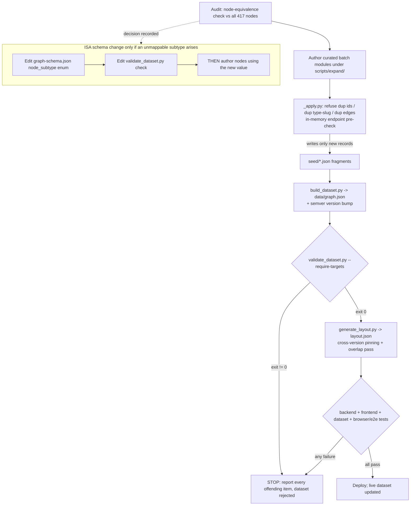

# Design Document

## Overview

Phase 1E — **Computer Science Domain Expansion** — broadens the TechAtlas knowledge graph to
cover 15 under-represented CS fields (Computer Architecture, Computer Networks, Embedded &
Real-Time Systems, High-Performance Computing, Performance Analysis, Algorithms & Complexity,
Cryptography, Logic & Verification, Human-Computer Interaction, Robotics, Computer Graphics,
Visualization, Computer Vision, Natural Language Processing, Web & Information Retrieval).

This is a **data and tooling expansion, not a new application.** It introduces **no new
services, no new runtime behavior, and no new schema node types.** Every addition is a
hand-curated node or edge that flows through the pipeline that already exists:

```
data/seed/{domains,concepts,technologies,edges}.json   (hand-authored fragments)
        │  scripts/expand/*.py  →  scripts/expand/_apply.py   (merge curated literals,
        │                                                       refuse dups, pre-check endpoints)
        ▼
scripts/build_dataset.py   →   data/graph.json
        ▼
scripts/validate_dataset.py --require-targets            (data-quality + milestone gate)
        ▼
scripts/generate_layout.py →   data/layout.json          (deterministic, cross-version pinned)
        ▼
backend /api/v1 (additive) + frontend render + Detail_Panel
```

The design is deliberately **minimal and reuse-first**:

- The schema already models the Field / Concept / Technology distinction via the closed
  `node_type` enum, and the technology classification via the closed `node_subtype` enum. No
  structural change is needed for 14 of the 15 fields.
- The **only** candidate schema change is whether an instruction-set architecture (RISC-V,
  ARM, x86) needs a new `node_subtype` value. This design **recommends mapping ISAs to the
  existing `architecture` subtype** and records that decision (see Requirement 1 / ISA
  decision table), so **Phase 1E ships with zero schema changes** unless curation later
  surfaces a genuinely unmappable value.
- The Detail_Panel **already** surfaces `node_type` and `node_subtype`
  (`frontend/src/components/NodeDetailsPanel.tsx` → `nodeTypeLabel(detail.node_type,
  detail.node_subtype)` in `frontend/src/graph/relationships.ts`). The design only needs a
  test that locks this behavior and confirms a new subtype label renders gracefully through
  the generic `subtype.replace(/_/g, " ")` path — **no new UI code is required.**

Phase 1E is independent of the Repo X-Ray scanner (Requirement 12): it touches only seed
data, the schema/validator (conditionally), the layout pipeline, and a Detail_Panel test. New
technology nodes must still carry correct `package` / `repo` / `aliases` so the scanner keeps
matching, but Phase 1E never calls or depends on scanner code.

### Research notes informing the design (audited, not invented)

- **`scripts/expand/_apply.py`** merges curated literals and refuses to add a duplicate node
  id, a duplicate `(node_type, slug)` pair, or a duplicate edge (symmetric types
  `related_to`, `integrates_with`, `alternative_to`, `commonly_used_with` deduped by
  unordered pair). It **pre-checks endpoint rules in-memory before any write**, so an invalid
  edge can never be persisted. Its `ENDPOINT_RULES` cover `belongs_to_domain`,
  `has_subdomain`, `implements`, `used_for`, `supports`, `enables`, and `written_in`.
- **Key finding:** the symmetric types (`related_to`, `integrates_with`, `alternative_to`,
  `commonly_used_with`) have **no endpoint-type restriction** in either `_apply.py` or
  `validate_dataset.py`. Cross-domain edges built on these types will pass endpoint checks by
  default. The design therefore treats "endpoints are sensible" as a **curation
  responsibility enforced by review and the audit step**, not something the validator can
  catch — and prefers typed relationships (`used_for`, `enables`, `depends_on`) over
  `related_to` wherever a directed meaning is accurate, so provenance and intent are explicit.
- **`scripts/validate_dataset.py`** enforces unique ids, unique `(node_type, slug)`,
  cross-type slug uniqueness, id-prefix/`node_type` agreement, existing edge endpoints, no
  self-edges, no duplicate edges, the same endpoint rules, `written_in` → programming_language,
  `primary_domain` references an existing domain, http(s) URLs, alias collisions (warn), and
  reports inferred (`is_curated=false`) and orphan nodes. With `--require-targets` it also
  enforces `>= 250` technologies and `150..170` concepts (`check_targets`).
- **`scripts/generate_layout.py`** is deterministic (seeded only by node id), orders the
  domain ring by inter-domain connectivity, and does **cross-version pinning**: it reuses
  previous coordinates only when `prev_version != dataset.version` (a genuine incremental
  update), freezes pinned nodes far from any change, and runs a radius-aware overlap pass
  using radii from `scripts/sizing.py`. When versions match (or no previous file), it
  recomputes from the deterministic seed, so a fresh run is byte-identical on re-run.
- **`scripts/sizing.py`** is the single source of truth for render radius and the overlap
  margin (`OVERLAP_MARGIN` lives in the layout generator; band sizes in `sizing.py`), shared
  by the layout generator and the backend.

## Architecture

### Data-flow / control-flow



The expansion is executed in **four strictly ordered priority batches** (Requirement 3.7):
**Systems → Theory → Interdisciplinary → AI.** No node or edge for a lower-priority area is
authored before every node and edge for all higher-priority areas is committed. Each batch is
its own module under `scripts/expand/` (e.g. `systems_cs.py`, `theory.py`, `interdisc.py`,
`ai_expansion.py`) that declares curated `NODES`/`EDGES` literals and calls `apply_batch()`.

### Components touched (and NOT touched)

| Component | Change in Phase 1E | Rationale |
|---|---|---|
| `data/seed/*.json` | Add curated nodes/edges only | Hand-authored data is the product of this phase |
| `scripts/expand/*.py` | New batch modules calling `_apply.py` | Reuse existing dedup + endpoint pre-check |
| `scripts/expand/_apply.py` | **No change** | Already refuses dups and pre-checks endpoints |
| `scripts/build_dataset.py` | Bump `DATASET_VERSION` (semver) | Content changed → version bump (Req 11.2) |
| `scripts/validate_dataset.py` | **No change** unless ISA subtype added | Closed-enum authority (Req 10) |
| `data/schema/graph-schema.json` | **No change** unless ISA subtype added | Recommended ISA → existing `architecture` |
| `scripts/generate_layout.py` | **No change** | Deterministic + pinning already correct |
| `scripts/sizing.py` | **No change** | Single sizing source already shared |
| `frontend/.../NodeDetailsPanel.tsx` | **No code change**; add a test | Already renders `node_type`/`node_subtype` |
| `backend/app/*` | **No change** | `/api/v1` is additive; new nodes flow through unchanged |
| Repo X-Ray scanner | **No change / no dependency** | Independence (Req 12) |

## Components and Interfaces

### 1. Audit step (Requirement 6) — authoring-time, not a program

Before authoring any batch, perform a **node-equivalence check** of every planned entity
against all 417 existing nodes. Two entities are **equivalent** when they resolve to the same
real-world entity, determined by either:

- **normalized name match** — case-insensitive, whitespace- and punctuation-trimmed; or
- a shared **`(node_type, slug)`** pair.

Normalization mirrors the validator's `_normalize` intent (lowercase; keep `+`/`#` so `C`,
`C++`, `C#`, `F#` stay distinct). If an existing node is equivalent, **reuse its
Canonical_ID** and author edges to it rather than creating a new node. Illustrative helper
(planning pseudocode only — not committed code):

```python
def normalized_name(s: str) -> str:
    return "".join(ch for ch in s.lower() if ch.isalnum() or ch in "+#")

def find_equivalent(planned, existing_nodes):
    pn = normalized_name(planned["name"])
    for n in existing_nodes:  # all 417
        if normalized_name(n["name"]) == pn:
            return n["id"]
        if (n["node_type"], n["slug"]) == (planned["node_type"], planned["slug"]):
            return n["id"]
    return None  # genuinely new -> mint a fresh Canonical_ID
```

`_apply.py` is the **enforcement backstop**: even if the manual audit misses an equivalent,
`_apply.py` refuses the duplicate id / `(node_type, slug)` and `validate_dataset.py` fails on
any duplicate that slips through. The audit is the first line; the tooling is the guarantee.

Likely reuse candidates to confirm during the audit (examples to verify against seed, not
assumed present): `Python`, `CUDA`, `TCP/IP`, `OpenCV`, `Vulkan` may already exist and must
be reused if so; the audit search above against `data/seed/*.json` returned no matches for
several candidate slugs, meaning most Phase 1E entities are genuinely new — but every one is
re-checked at authoring time.

### 2. Batch module contract (reusing `_apply.py`)

Each batch module is a thin, data-only module:

```python
# scripts/expand/systems_cs.py  (illustrative shape, not committed)
from _apply import apply_batch

CONCEPTS = [ {"id": "concept:cache-coherence", "slug": "cache-coherence",
              "name": "Cache Coherence", "node_type": "concept",
              "primary_domain": "domain:systems",
              "short_description": "...", "wikipedia_title": "Cache coherence"}, ... ]
TECHNOLOGIES = [ {"id": "technology:risc-v", "slug": "risc-v", "name": "RISC-V",
                  "node_type": "technology", "node_subtype": "architecture",
                  "primary_domain": "domain:systems", "short_description": "...",
                  "wikipedia_title": "RISC-V", "aliases": ["RISCV", "RISC V"],
                  "official_url": "https://riscv.org"}, ... ]
EDGES = [ {"source": "concept:cache-coherence", "target": "domain:systems",
           "relationship_type": "belongs_to_domain", "is_curated": True,
           "source_reference": "Hennessy & Patterson, Computer Architecture"}, ... ]

if __name__ == "__main__":
    apply_batch("systems-cs", concepts=CONCEPTS, technologies=TECHNOLOGIES, edges=EDGES)
```

`apply_batch` already: builds a merged node-id map (existing + curated), **pre-checks every
new edge's endpoints in-memory and raises `SystemExit` before writing** if any fails, skips
already-present nodes/edges, and appends only new records in the existing 2-space JSON style.

### 3. Validator (Requirement 10, 11) — authority preserved

`validate_dataset.py` stays authoritative and is run twice conceptually: during iteration
without `--require-targets` (so intermediate commits aren't blocked) and at the acceptance
gate **with** `--require-targets`. Exit code 0 (warnings allowed) with the gate is the sole
acceptance signal. The validator already reports **every** offending item in a single run
(it accumulates into `report.errors`/`report.warnings` and prints them all before exiting
non-zero), satisfying "report all offenders in one run" for duplicate ids, duplicate
`(node_type, slug)`, and out-of-enum values.

### 4. Layout (Requirement 9) — unchanged, used as-is

New top-level domains (if any) are placed by `generate_layout.py` purely through its existing
deterministic pipeline: the domain is added to the connectivity-ordered ring, seeded near its
anchor by the id-hash, relaxed with Barnes-Hut force + radius-aware overlap, and pinned on
subsequent versions. Because content changed, the **version bump** makes
`prev_version != dataset.version`, which is exactly the condition under which
`generate_layout.py` reuses the previous coordinates for unchanged nodes (zero positional
delta) while letting new nodes and their 2-hop neighborhood settle.

### 5. Detail_Panel (Requirement 1.4/1.5) — already satisfied, locked by test

`NodeDetailsPanel.tsx` already renders `nodeTypeLabel(detail.node_type,
detail.node_subtype)`. For a technology it shows e.g. `Technology · architecture`; for a
domain/concept it shows just `Domain` / `Concept` (no subtype). A new subtype value renders
through the generic underscore-to-space path, so no code change is needed. Phase 1E adds a
unit test asserting both cases.

## Data Models

Phase 1E adds **instances**, not new model shapes. All additions conform to the existing
`data/schema/graph-schema.json`.

### Node (unchanged shape; Phase 1E-relevant fields)

| Field | Phase 1E rule |
|---|---|
| `id` | Mint `^(domain|concept|technology):[a-z0-9-]+$`, globally unique, never reuses/reassigns an existing id |
| `slug` | Unique within and across node types (validator enforces cross-type uniqueness) |
| `node_type` | Exactly one of `domain` / `concept` / `technology` (Req 1.1) |
| `node_subtype` | Set **only** on technologies, from the closed enum (Req 1.2/1.3) |
| `primary_domain` | References an existing `domain:` node (Req 2.6/2.7) |
| `wikipedia_title` | Exact article title, never name-derived (Req 7.7) |
| `package` / `repo` / `aliases` | Populated on real technologies so the Scanner matches (Req 8.4/8.5, 12.2) |
| `importance` / `lifecycle_status` | Editorial; used by sizing |

### Edge (unchanged shape; Phase 1E-relevant fields)

| Field | Phase 1E rule |
|---|---|
| `relationship_type` | Exactly one closed-enum value (Req 5.1/5.2) |
| `source_reference` | Non-empty provenance on every significant/cross-domain edge (Req 5.3/5.4, 7.6) |
| `is_curated` | `true` only when hand-verified against the source; else `false` (Req 5.6) |
| `weight` / `confidence` / `description` | Optional, as today |

### Taxonomy decision table (Requirement 4)

Each of the 15 fields is classified as exactly one of: **new top-level Domain**, **Subdomain**
(`domain -has_subdomain-> domain`), or **Concept_Hub** (a `concept` node under an existing
domain). Rationale is recorded per field (Req 4.3); a field cannot enter the graph without its
recorded decision.

| # | Field | Priority | Decision | Parent / Host | Rationale |
|---|---|---|---|---|---|
| 1 | Computer Architecture | 1 Systems | **Subdomain** | `domain:systems` | Core of low-level engineering; belongs under Systems, not its own cluster |
| 2 | Computer Networks | 1 Systems | **New top-level Domain** `domain:networks` *(open Q)* | — (cross-links to backend, security) | Breadth spans Backend + Security + Systems; large enough to anchor its own community. Fallback: Subdomain of Systems |
| 3 | Embedded & Real-Time Systems | 1 Systems | **Subdomain** | `domain:systems` | Firmware/RTOS/microcontrollers are a Systems branch |
| 4 | High-Performance Computing | 1 Systems | **Subdomain** | `domain:systems` | Parallelism/CUDA/MPI are Systems-adjacent; cross-links to AI + architecture |
| 5 | Measurement & Performance Analysis | 1 Systems | **Concept_Hub** `concept:performance-analysis` | `domain:systems` | A cross-cutting practice (benchmarking/profiling/latency), too narrow for its own cluster |
| 6 | Algorithms & Complexity | 2 Theory | **Subdomain** | `domain:theory` (new) | Foundational theory; hosted by a new Theory domain |
| 7 | Logic & Verification | 2 Theory | **Subdomain** | `domain:theory` (new) | Formal methods/model checking/SAT-SMT belong with Theory |
| 8 | Cryptography | 2 Theory | **Concept_Hub** `concept:cryptography` | `domain:theory`; cross-link to `domain:security` | Mathematically a theory topic; applied in Security — hub keeps one canonical home and cross-links |
| — | *(Theory host)* | 2 | **New top-level Domain** `domain:theory` | — | No existing domain hosts pure CS theory; anchors Algorithms + Logic |
| 9 | Human-Computer Interaction | 3 Interdisc. | **Concept_Hub** `concept:human-computer-interaction` | `domain:frontend`; cross-link to frontend/accessibility/design/visualization | UX/usability/accessibility strongly relate to Frontend; hub avoids a thin top-level cluster |
| 10 | Robotics | 3 Interdisc. | **New top-level Domain** `domain:robotics` *(open Q)* | — (cross-links to AI, systems) | Distinct engineering field (ROS 2/SLAM/motion planning); fallback: Subdomain of Systems |
| 11 | Computer Graphics | 3 Interdisc. | **Subdomain** | `domain:gamedev` | Rendering/shaders/ray tracing/Vulkan overlap the existing Game Development & Graphics domain |
| 12 | Visualization | 3 Interdisc. | **Concept_Hub** `concept:data-visualization` | `domain:frontend` | Data/scientific viz + D3.js relate to Frontend; too narrow for its own cluster |
| 13 | Computer Vision | 4 AI | **Subdomain** | `domain:ai-ml` | Reuse existing AI domain; CV is a branch (Req 4.8 — no duplicate domain) |
| 14 | Natural Language Processing | 4 AI | **Subdomain** | `domain:ai-ml` | Reuse existing AI domain; NLP is a branch |
| 15 | Web & Information Retrieval | 4 AI | **Concept_Hub** `concept:information-retrieval` | `domain:ai-ml` | Search/indexing/ranking/vector-search/RAG groups well as a hub under AI |

**New top-level domains proposed:** `domain:theory`, and (open questions) `domain:networks`,
`domain:robotics`. If an open question resolves to "not top-level," the fallback in the table
applies and the field becomes a Subdomain of `domain:systems` with no other change.

**Subdomain realization:** one `has_subdomain` edge `domain:<parent> -has_subdomain->
domain:<child>` (both endpoints are domains, satisfying the validator rule). A Subdomain is a
`domain` node with its own `primary_domain` set to itself (consistent with existing domains).

**Concept_Hub realization:** a single `concept` node; children attach via a closed-enum
relationship (`belongs_to_domain` to the host domain for the hub itself, and
`related_to`/`implements`/`used_for`/`enables` from children to the hub). No new `domain` node
is created for a hub (Req 4.6/4.8).

### ISA decision table (Requirement 1.7/1.8, 10)

| Option | What it requires | Pros | Cons | Decision |
|---|---|---|---|---|
| (a) Add `instruction_set_architecture` to `node_subtype` enum | Edit `graph-schema.json` enum **and** `validate_dataset.py` in the same change set **before** any node uses it (Req 10.3) | Most precise label in Detail_Panel | A real schema change (MINOR bump surface); more moving parts | Not chosen |
| (b) **Map every ISA to existing `architecture`** | No schema/validator change | Zero schema risk; `architecture` is already in the enum and semantically defensible for RISC-V/ARM/x86 | Slightly less specific label ("architecture" not "ISA") | **Recommended** |

**Recommendation:** adopt option (b) — map every ISA (RISC-V, ARM, x86, MIPS) to the existing
`architecture` subtype, applied **identically to every ISA node** (Req 1.7). This keeps Phase
1E schema-change-free. Record this as the explicit documented decision. Option (a) is held in
reserve: if curation surfaces a technology with no defensible existing subtype, it is handled
via the Requirement 10 schema-change procedure below (schema + validator updated first,
in one change set, before any node references the value).

### Cross-domain edge list (Requirement 5)

All cross-domain edges carry a non-empty `source_reference` and `is_curated=true` only when
hand-verified. Typed relationships are preferred over `related_to` where a directed meaning is
accurate; `related_to` is used only for genuinely symmetric associations. Because
`related_to`/`integrates_with` have no validator endpoint rule, endpoints are kept sensible by
curation + review. Target ids assume audit-confirmed canonical nodes (reuse where they exist).

| Source | Target | relationship_type | is_curated | Provenance (source_reference, abbrev.) |
|---|---|---|---|---|
| Computer Networks | `domain:backend` | `related_to` | true | Kurose & Ross, *Computer Networking* |
| Computer Networks | `domain:security` | `related_to` | true | Stallings, *Network Security Essentials* |
| Computer Networks | networking concepts (TCP/IP, DNS, routing) | `belongs_to_domain`/`related_to` | true | RFC 1122; RFC 1034 |
| Computer Vision | `domain:ai-ml` | `belongs_to_domain` | true | Szeliski, *Computer Vision* |
| Computer Vision | `domain:robotics` (or Robotics hub) | `used_for` | true | Thrun et al., *Probabilistic Robotics* |
| Computer Vision | Graphics (gamedev) | `related_to` | true | Foley et al., *Computer Graphics* |
| Computer Vision | `technology:python` | `written_in` *(only if tech→lang holds)* / else `used_for` | true | OpenCV Python bindings docs |
| Computer Vision | GPU computing (CUDA) | `depends_on`/`used_for` | true | NVIDIA cuDNN docs |
| Cryptography | `domain:theory` | `belongs_to_domain` | true | Katz & Lindell, *Intro to Modern Cryptography* |
| Cryptography | `domain:security` | `used_for` | true | Katz & Lindell, ch. on applications |
| Cryptography | authentication concept | `enables` | true | RFC 8446 (TLS 1.3) |
| Cryptography | distributed systems concept | `used_for` | true | Nakamoto, Bitcoin whitepaper (hashing/signatures) |
| High-Performance Computing | computer architecture | `depends_on` | true | Hennessy & Patterson |
| High-Performance Computing | CUDA | `used_for` | true | NVIDIA CUDA Programming Guide |
| High-Performance Computing | distributed computing concept | `related_to` | true | Pacheco, *Intro to Parallel Programming* |
| High-Performance Computing | machine learning | `enables` | true | Goodfellow et al., *Deep Learning* (hardware ch.) |
| Human-Computer Interaction | `domain:frontend` | `related_to` | true | Norman, *The Design of Everyday Things* |
| Human-Computer Interaction | accessibility concept | `enables` | true | W3C WCAG 2.2 |
| Human-Computer Interaction | design concept | `related_to` | true | Shneiderman, *Designing the User Interface* |
| Human-Computer Interaction | Visualization hub | `related_to` | true | Munzner, *Visualization Analysis & Design* |

`written_in` is only used where the target is a `programming_language` node (validator rule);
otherwise the relationship falls back to `used_for`/`depends_on`. Every edge above is subject
to the audit (reuse canonical targets) and the `_apply.py` endpoint pre-check.

### Schema-change procedure (Requirement 10) — only if option (a) is ever needed

If, and only if, curation surfaces an unmappable `node_subtype` or `relationship_type`:

1. **Edit `data/schema/graph-schema.json`** — add the new string literal to the relevant
   `enum` array:
   - `node_subtype` enum lives under
     `definitions.node.properties.node_subtype.enum` (add e.g.
     `"instruction_set_architecture"`).
   - `relationship_type` enum lives under
     `definitions.edge.properties.relationship_type.enum`.
2. **Edit `scripts/validate_dataset.py` in the same change set** — the validator currently
   trusts the JSON-schema enum implicitly for `node_subtype` and only special-cases
   `written_in`; adding a value means (a) ensuring any endpoint rule in `ENDPOINT_RULES`
   references it where relevant, and (b) if the validator is extended to assert membership
   explicitly, updating that allow-set. `_apply.py`'s mirrored `ENDPOINT_RULES` must be kept
   in sync if the new value participates in an endpoint rule.
3. **Only then** author any node/edge using the new value. The validator reports **all**
   offending nodes/edges in a single run and exits non-zero if any value is out-of-enum
   (Req 10.4).

This ordering guarantees no node ever references a value the schema/validator does not yet
know (Req 1.8, 10.2, 10.3).

## Correctness Properties

*A property is a characteristic or behavior that should hold true across all valid executions
of a system — essentially, a formal statement about what the system should do. Properties
serve as the bridge between human-readable specifications and machine-verifiable correctness
guarantees.*

Phase 1E is a data/tooling expansion, but its **pure-logic surfaces** — the validator's
checks, the equivalence/merge logic, the sizing function, and the deterministic layout — are
genuine "for all graphs" properties and are well-suited to property-based testing. The UI
rendering, curation-judgement, and pipeline-orchestration criteria are covered by
example/integration/visual-regression tests in the Testing Strategy instead.

### Property 1: Closed-enum invariant

*For any* dataset, every node's `node_type` and (when present) `node_subtype`, and every
edge's `relationship_type`, is a member of the corresponding closed enum in
`data/schema/graph-schema.json`; and *for any* dataset containing one or more out-of-enum
values, validation fails and reports an error for **every** offending node or edge in a
single run.

**Validates: Requirements 1.2, 1.8, 2.5, 4.7, 5.1, 5.2, 7.2, 7.3, 7.4, 10.1, 10.2, 10.4**

### Property 2: node_subtype permitted only on technologies

*For any* node, `node_subtype` is present if and only if `node_type` is `technology`; a
`node_subtype` set on a `domain` or `concept` node is rejected and not persisted.

**Validates: Requirements 1.2, 1.3**

### Property 3: No-duplication / idempotent merge

*For any* existing dataset and *any* planned entity equivalent to a node already present,
applying the batch adds zero new nodes and reuses the existing Canonical_ID; the resulting
dataset contains no duplicate node ids and no duplicate `(node_type, slug)` pairs, and *for
any* dataset with injected duplicates the validator fails and reports every conflicting id or
`(node_type, slug)` pair.

**Validates: Requirements 3.8, 4.8, 6.3, 6.4, 6.7, 6.8**

### Property 4: Node-equivalence function correctness

*For any* pair of a planned entity and an existing node, the equivalence decision is true if
and only if their normalized names are equal (case-insensitive, whitespace/punctuation
trimmed, preserving `+` and `#`) or they share the same `(node_type, slug)` pair.

**Validates: Requirements 6.2**

### Property 5: Canonical-ID pattern and global uniqueness

*For any* newly added node, its Canonical_ID matches `^(domain|concept|technology):[a-z0-9-]+$`
and is distinct from every pre-existing Canonical_ID and from every other Canonical_ID added
during Phase 1E.

**Validates: Requirements 6.5**

### Property 6: Canonical-ID preservation

*For any* Phase 1E expansion of the base dataset, the set of pre-existing Canonical_IDs is
preserved exactly — no pre-existing id is removed, renamed, or reassigned — so the base id set
is identical before and after expansion.

**Validates: Requirements 6.6**

### Property 7: Relationship endpoint rules

*For any* edge, the validator accepts it if and only if its endpoints satisfy the applicable
endpoint rule: `has_subdomain` requires both endpoints to be `domain` nodes, `belongs_to_domain`
requires a `domain` target, `written_in` requires a `programming_language` target, and the
other ruled types (`implements`, `used_for`, `supports`, `enables`) match their declared
source/target node types.

**Validates: Requirements 2.2, 3.4, 4.5, 5.8**

### Property 8: Provenance on significant edges

*For any* cross-domain or otherwise significant edge, the edge is accepted if and only if it
carries a non-empty `source_reference` (length >= 1); an edge with a missing or empty
`source_reference` is rejected and recorded nowhere in the graph.

**Validates: Requirements 5.3, 5.4, 7.6**

### Property 9: primary_domain references an existing domain

*For any* added node, the node is accepted if and only if its `primary_domain` references the
id of an existing `domain` node; otherwise it is rejected and not persisted.

**Validates: Requirements 2.6, 2.7**

### Property 10: Field classification is exactly one category

*For any* Phase 1E field, it is accepted into the graph if and only if it is assigned exactly
one of {new top-level Domain, Subdomain, Concept_Hub}; a field assigned zero or more than one
category is rejected and excluded.

**Validates: Requirements 4.1, 4.2**

### Property 11: Classification-decision record completeness

*For any* field added to the graph, there exists a recorded classification decision naming the
chosen category, the parent Domain identifier (for Subdomain and Concept_Hub), and a non-empty
rationale; a field whose decision record is missing any required part is rejected.

**Validates: Requirements 4.3, 4.4**

### Property 12: Concept_Hub creates exactly one concept node and no domain

*For any* field classified as a Concept_Hub, the expansion creates exactly one `concept` node
for it and creates no new `domain` node, and every child entity attaches to the hub via a
closed-enum `relationship_type`.

**Validates: Requirements 3.5, 4.6**

### Property 13: ISA nodes share one chosen subtype

*For any* node representing an instruction set architecture, its `node_subtype` equals the
single value selected by the ISA decision (recommended: `architecture`), applied identically
to every ISA node.

**Validates: Requirements 1.7**

### Property 14: Sizing regression and popularity fallback

*For any* technology node and popularity input, `scripts/sizing.py` produces the same radius
the Phase 1D formula produced for identical inputs; and *for any* technology with no sourced
popularity, sizing uses the connectivity fallback and the technology is marked as having no
popularity score (never a fabricated or default non-fallback value).

**Validates: Requirements 8.1, 8.8**

### Property 15: Scanner-required field presence

*For any* added Technology node that corresponds to a real package or repository, it is
accepted if and only if it carries the `package`, `repo`, and `aliases` fields needed for
Scanner resolution; a node missing any required field is rejected during validation with the
missing field named.

**Validates: Requirements 8.5, 12.2**

### Property 16: Search by name or alias

*For any* node and *any* token drawn from its `name` or declared `aliases`, a search query for
that token returns the node in its results.

**Validates: Requirements 8.2**

### Property 17: Exact wikipedia_title resolution

*For any* node that has a `wikipedia_title`, Wikipedia identity resolution uses that exact
value verbatim and never a name-derived lookup.

**Validates: Requirements 8.3**

### Property 18: Backward-compatible shape superset

*For any* `/api/v1` response and for the graph schema, the set of fields and structural
elements present before Phase 1E is a subset of the set present after Phase 1E — no existing
field is removed or renamed; all changes are additive.

**Validates: Requirements 8.6, 8.7**

### Property 19: Layout determinism

*For any* dataset, running `scripts/generate_layout.py` two or more times against the same
Dataset_Version produces byte-identical node coordinates across all runs.

**Validates: Requirements 9.1, 9.2**

### Property 20: Cross-version coordinate stability

*For any* version bump in which a subset of nodes is unchanged, the layout for the new
Dataset_Version reproduces the exact prior coordinates (zero positional delta on both axes)
for every unchanged node via cross-version pinning.

**Validates: Requirements 9.3**

### Property 21: No-overlap margin

*For any* generated layout, every pair of node bubbles has an edge-to-edge gap greater than or
equal to the minimum margin, using the radii and margin sourced from `scripts/sizing.py`.

**Validates: Requirements 9.2, 9.4**

### Property 22: Require-targets gate correctness

*For any* dataset, `scripts/validate_dataset.py --require-targets` exits 0 if and only if every
validation check passes and the milestone target counts (`>= 250` technologies,
`150..170` concepts inclusive) are met; otherwise it exits non-zero.

**Validates: Requirements 11.1**

## Error Handling

All error handling reuses existing, fail-fast mechanisms — Phase 1E adds no new error paths.

| Condition | Handler | Behavior |
|---|---|---|
| Duplicate id / `(node_type, slug)` | `_apply.py` (skip) + `validate_dataset.py` (error) | New record skipped at merge; validator reports every conflict and exits non-zero |
| Edge endpoint-rule violation | `_apply.py` `_precheck` (in-memory) | `SystemExit` **before any write**; no stale invalid edge persists |
| Out-of-enum `node_subtype`/`relationship_type` | `validate_dataset.py` | Reports every offending node/edge in one run; exits non-zero |
| `node_subtype` on domain/concept | Validator (added-rule) / curation gate | Rejected with message that subtype is technology-only; not persisted |
| `primary_domain` missing/not-a-domain | `validate_dataset.py` | Reports the offending node; exits non-zero |
| Missing/empty `source_reference` on significant edge | Curation gate + review | Edge not added |
| Scanner-required field missing on real tech | Validation gate | Node rejected with the missing field named |
| Milestone counts not met | `--require-targets` (`check_targets`) | Non-zero exit; lists which count is out of range |
| Layout cannot satisfy overlap/pinning | `generate_layout.py` | Abort without writing a partial/shifted file; report violated constraint + node id (Req 9.5) |
| Any Build_Pipeline stage or e2e test fails | Deploy orchestration | Abort deploy, leave live dataset unchanged, report failing stage/test (Req 11.4) |

The validator's `Report` object **accumulates** all errors and prints them before exiting, so
"report every offender in one run" (Req 6.8, 10.4) is satisfied by the existing design.

## Testing Strategy

A dual approach: **property-based tests** for the pure-logic invariants above, and
**example / integration / visual-regression tests** for UI, external services, curation
judgement, and pipeline orchestration.

### Property-based tests (pure logic)

- **Library:** Python **Hypothesis** for the dataset/validator/sizing/layout layer (backend
  is Python); TypeScript **fast-check** for the search/shape layer if tested in the frontend.
  Do **not** hand-roll property testing.
- **Iterations:** minimum **100** per property.
- **Tagging:** each property test carries a comment
  `Feature: techatlas-phase-1e-cs-domain-expansion, Property {n}: {property text}`.
- **One property → one property-based test.** Coverage map:
  - Properties 1, 2, 3, 7, 9, 22 → generate random node/edge sets and run `validate` /
    `_precheck`; assert accept/reject matches the invariant and all offenders are reported.
  - Property 4 → generate name/slug pairs; assert the equivalence function matches its
    definition (including `+`/`#` preservation).
  - Properties 5, 6 → generate base + expansion id sets; assert pattern, global uniqueness,
    and preservation of the base set.
  - Properties 10, 11, 12 → generate field-classification records; assert exactly-one-category,
    record completeness, and the hub realization (one concept node, no new domain).
  - Property 13 → generate ISA nodes; assert all share the one chosen subtype.
  - Property 14 → generate tech nodes + popularity; assert `node_radius` equals the Phase 1D
    formula and the fallback branch is used when popularity is absent.
  - Property 15 → generate techs with/without `package`/`repo`/`aliases`; assert reject-with-
    named-field iff missing.
  - Property 16 → generate nodes; assert search returns the node for every name/alias token.
  - Property 17 → generate nodes with `wikipedia_title`; assert the resolver uses it verbatim
    (fetch mocked).
  - Property 18 → snapshot the pre-expansion response/schema field set; assert the post-
    expansion set is a superset.
  - Properties 19, 20, 21 → generate datasets; run `generate_layout.py`; assert byte-identical
    re-runs, zero-delta pinning across a version bump, and the sizing.py no-overlap margin.

### Example / unit tests

- The three concrete classifications (Req 1.6: Computer Architecture=domain, Cache
  Coherence=concept, RISC-V=technology).
- Per-batch coverage presence (Req 2.1, 3.1–3.3): each sub-area has `>= 1` node after its
  batch.
- Named cross-domain edges present with enum type + provenance (Req 3.6, 5.5).
- Single-sizing-source static check (Req 9.6): assert no sizing/margin constants are defined
  outside `scripts/sizing.py` and that both the layout generator and backend import it.
- Semver sanity (Req 11.2): new `DATASET_VERSION` is valid semver and strictly greater than
  the previous.

### Frontend component test (Detail_Panel, Req 1.4/1.5)

- Using the existing `NodeDetailsPanel.test.tsx` harness: render a `technology` node and
  assert the type line shows `Technology · <subtype>`; render a `domain`/`concept` node and
  assert it shows just `Domain`/`Concept` with no subtype. Add a case with a **new** subtype
  string to confirm it renders through the generic underscore-to-space path without code
  change.

### Integration / visual-regression / process tests

- **Scanner integration (Req 8.4):** 1–3 example scans against repository fixtures confirming a
  new tech node resolves via `package`/`repo`/`aliases`. (PBT is not appropriate here — this
  exercises the separate scanner component; Phase 1E only guarantees field presence via
  Property 15.)
- **Browser/e2e render (Req 11.5):** Playwright suite renders the expanded graph; snapshot /
  visual regression confirms pre-existing nodes/edges look and lay out as before (coordinate
  stability is already covered by Property 20).
- **Pipeline orchestration (Req 11.3/11.4, 12.1):** a script/CI test asserting the stage order
  `build_dataset → validate --require-targets → generate_layout → tests`, that deploy is gated
  on all passing, and that the pipeline completes with scanner code absent/disabled.
- **ISA option-(a) guard (Req 10.3):** if the schema change is ever taken, a CI check asserts
  `graph-schema.json` and `validate_dataset.py` change in the same change set before any node
  uses the value (usage-after is independently caught by Property 1).

### Why not more property tests

Curation-judgement criteria (5.6 `is_curated` truthfulness, 5.7 unsupported-provenance
omission, 7.5 no-fabrication, 7.7 exact-title correctness) depend on human source
verification and are **not machine-decidable** — they are handled by review plus the
observable provenance-presence Property 8. Ordering/scope criteria (3.7, 11.3, 12.3) are
process constraints, not dataset properties. The scanner resolution path (8.4) is an external
component exercised by integration examples, not PBT.

## How the Non-Functional Constraints are honored

| NFR | How Phase 1E honors it |
|---|---|
| **NFR-1 Canonical identity** | Audit-first equivalence check (Property 4) + `_apply.py` dedup + Properties 3/5/6 (no dups, unique new ids, preserved base ids) |
| **NFR-2 No fabrication** | Every significant edge carries `source_reference` (Property 8); `is_curated=true` only when hand-verified; absence encoded as absence (no fabricated popularity — Property 14 fallback) |
| **NFR-3 Closed enums** | Properties 1/2/13 + the Requirement 10 schema-change procedure (schema + validator updated before use); recommended ISA mapping avoids any enum change |
| **NFR-4 Validation gate** | `validate_dataset.py --require-targets` exit 0 is the sole acceptance signal (Property 22); semver bump in `build_dataset.py` |
| **NFR-5 Determinism** | Properties 19/20/21 — byte-identical re-runs, zero-delta pinning, sizing.py no-overlap margin; pipeline is CI-reproducible |
| **NFR-6 Preservation** | Properties 14 (popularity), 16 (search), 17 (exact wikipedia_title), 15 (scanner package/repo/alias fields) |
| **NFR-7 Backward compatibility** | Property 18 — schema and `/api/v1` response shapes are supersets; new data additive only |
| **NFR-8 Pre-deploy verification** | Build_Pipeline + backend/frontend/dataset/browser tests all pass before deploy (orchestration tests; Req 11.3/11.4) |

## Open Questions (with recommended defaults so tasks stay actionable)

1. **Is Computer Networks a new top-level `domain:networks` or a Subdomain of
   `domain:systems`?** Its breadth spans Backend, Security, and Systems, which argues for a
   top-level cluster. **Recommended default: new top-level `domain:networks`.** Fallback
   (if the map gets too crowded): Subdomain of `domain:systems` — no other change required.
2. **Does CS Theory get its own `domain:theory` (hosting Algorithms & Complexity and Logic &
   Verification, with Cryptography as a cross-linked Concept_Hub)?** No existing domain hosts
   pure theory. **Recommended default: yes, add `domain:theory`.** Alternative slug
   `domain:cs-theory` if `theory` reads ambiguously.
3. **Is Robotics a new top-level `domain:robotics` or a Subdomain of `domain:systems`?** It is
   a distinct engineering field (ROS 2, SLAM, motion planning) that also cross-links to AI.
   **Recommended default: new top-level `domain:robotics`.** Fallback: Subdomain of
   `domain:systems`.
4. **Is HCI a Concept_Hub under `domain:frontend` or its own Subdomain?** UX/usability/
   accessibility relate strongly to Frontend. **Recommended default: Concept_Hub
   `concept:human-computer-interaction` under `domain:frontend`**, cross-linked to
   accessibility/design/visualization. Promote to a Subdomain only if it accrues many children.
5. **ISA subtype: add `instruction_set_architecture` (schema change) or map to existing
   `architecture`?** **Recommended default: map to `architecture`** (option (b)) — zero schema
   change. Option (a) is held in reserve behind the Requirement 10 procedure.
6. **Where does Computer Graphics live — Subdomain of `domain:gamedev` or `domain:frontend`?**
   Rendering/shaders/ray tracing/Vulkan overlap the existing Game Development & Graphics
   domain. **Recommended default: Subdomain of `domain:gamedev`.**

Each default is concrete enough that task generation can proceed; flipping any open question to
its fallback changes only that field's parent/host, not the pipeline or any property.
